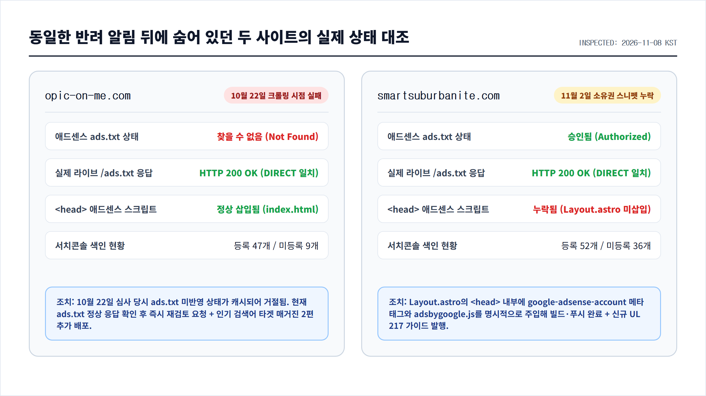
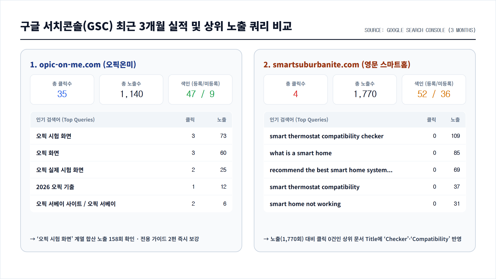

애드센스 관리 화면을 열었다가 한숨부터 나왔다. 영문 스마트홈 블로그인 `smartsuburbanite.com`과 오픽 학습 사이트인 `opic-on-me.com` 두 곳이 나란히 **"광고 게재가 준비되지 않은 사이트"** 판정을 받았기 때문이다.

더 답답한 건 안내 문구였다. 두 사이트 모두 토씨 하나 안 틀리고 똑같이 **"사이트 소유권을 확인하세요"**라는 문장과 **"정책 위반: 가치가 별로 없는 콘텐츠(Low-value content)"** 안내가 붙어 있었다. 안내문만 읽으면 두 사이트가 똑같은 이유로 떨어진 것처럼 보이지만, 실제로 애드센스 `[사이트]` 상세 테이블과 서치콘솔(GSC) 3개월 데이터를 나란히 띄워놓고 뜯어보니 **두 사이트가 막힌 지점은 완전히 달랐다.**

하나는 심사 시점의 `ads.txt` 크롤링 누락이었고, 다른 하나는 Astro 레이아웃 개편 과정에서 `<head>` 안의 애드센스 소유권 메타 태그가 빠진 채 심사봇이 빈손으로 돌아간 사고였다. 오늘 두 사이트를 동시에 디버깅하며 조치한 과정을 커밋 기록 그대로 남겨둔다.

---

## 1. 똑같은 반려 화면 뒤에 숨어 있던 진짜 단서: 애드센스 `[사이트]` 테이블

개별 사이트의 반려 상세 페이지에 들어가면 구글의 표준 도움말 링크 세 개(`애드센스 콘텐츠 및 사용자 환경`, `빈약한 콘텐츠에 대한 스팸 정책`, `웹 검색의 스팸 정책`)만 반복해서 나온다. 여기서 시간을 쓰면 영원히 원인을 못 찾는다. 진짜 단서는 애드센스 좌측 메뉴의 **`[사이트]` 전체 목록 테이블**에 있었다.



세 도메인의 상태를 한 줄씩 대조해 보니 이상한 점이 바로 눈에 들어왔다.

| 사이트 도메인 | 애드센스 상태 | 정책 표시 사유 | `ads.txt` 상태 | 마지막 확인 일시 (KST) |
| :--- | :--- | :--- | :--- | :--- |
| `opic-on-me.com` | 주의 필요 | 가치가 별로 없는 콘텐츠 | **찾을 수 없음** | 2026년 10월 22일 오후 11:42 |
| `smartsuburbanite.com` | 주의 필요 | 가치가 별로 없는 콘텐츠 | **승인됨** | 2026년 11월 2일 오후 1:25 |
| `natekeem.com` | 준비 중 | — | **승인됨** | 2026년 10월 21일 오전 12:20 |

두 사이트 모두 겉으로는 똑같은 반려 사유를 달고 있었지만, 기술적 상태는 정반대였다.

1. **`opic-on-me.com`의 문제 (`ads.txt: 찾을 수 없음`)**
   - 애드센스 봇이 마지막으로 확인한 시점이 **10월 22일 오후 11시 42분**에 멈춰 있었다.
   - 터미널에서 실제 라이브 서버(`https://opic-on-me.com/ads.txt`)를 조회해 보니 `google.com, pub-8734087248170812, DIRECT, f08c47fec0942fa0` 한 줄이 정상적으로 배포되어 있었고, `index.html`의 `<head>` 안에도 `adsbygoogle.js` 스크립트가 온전히 살아 있었다.
   - 즉 10월 22일 초기 배포 직후 `ads.txt`가 전파되기 전에 크롤러가 다녀가며 `찾을 수 없음` 상태가 박혔고, 그 이후로 재검토 요청이 들어가지 않아 이전 거절 상태가 그대로 남아 있던 것이다.
2. **`smartsuburbanite.com`의 문제 (`ads.txt: 승인됨`, 그러나 `<head>` 태그 누락)**
   - 반대로 영문 블로그는 11월 2일에 `ads.txt`가 **승인됨**으로 찍혀 있었다.
   - 그런데 왜 상세 창에 **"사이트 소유권을 확인하세요"**가 떴을까? 라이브 페이지 소스를 긁어보고서야 아차 싶었다. 지난번 UI 개편을 하면서 `public/ads.txt` 파일만 넣어두고, 정작 모든 페이지의 `<head>`를 렌더링하는 `src/layouts/Layout.astro`에는 `<meta name="google-adsense-account">` 태그도, `adsbygoogle.js` 스크립트도 넣지 않았던 것이다.

---

## 2. `smartsuburbanite.com`: `Layout.astro`에 소유권 메타 태그와 스크립트 이식

애드센스 심사봇은 루트 도메인의 `/ads.txt`만으로 사이트 검토를 끝내지 않는다. 실제 문서 페이지의 HTML `<head>`에 게시자 ID(`ca-pub-...`)가 포함된 메타 태그나 스크립트 스니펫이 들어 있어야 소유권 확인을 통과시키고 본문 품질 심사로 넘어간다.

즉시 `monetized_blogs/the-smart-suburbanite` 서브모듈의 설정 파일과 레이아웃을 열었다.

```typescript
// monetized_blogs/the-smart-suburbanite/astro-paper.config.ts
export const SITE: SiteConfig = {
  website: "https://smartsuburbanite.com/",
  author: "The Smart Suburbanite Editorial Team",
  profile: "https://smartsuburbanite.com/about/",
  desc: "Practical, source-backed guides to smart-home devices, privacy, compatibility, and everyday home decisions.",
  title: "The Smart Suburbanite",
  ogImage: "og.png",
  googleAdsenseAccount: "ca-pub-8734087248170812",
  // ...
};
```

그리고 `src/layouts/Layout.astro`의 `<head>` 블록에 메타 태그와 비동기 스크립트를 함께 주입했다.

```astro
<!-- monetized_blogs/the-smart-suburbanite/src/layouts/Layout.astro -->
{
  SITE.googleAdsenseAccount && (
    <>
      <meta
        name="google-adsense-account"
        content={SITE.googleAdsenseAccount}
      />
      <script
        is:inline
        async
        src={`https://pagead2.googlesyndication.com/pagead/js/adsbygoogle.js?client=${SITE.googleAdsenseAccount}`}
        crossorigin="anonymous"
      />
    </>
  )
}
```

Astro에서는 외부 스크립트 태그에 `is:inline` 속성을 명시해야 번들러가 임의로 모듈 변환을 시도하지 않고 `<head>`에 원형 그대로 출력한다. 수정 후 `pnpm --filter the-smart-suburbanite run build`를 돌려 생성된 103개 정적 HTML 페이지에 태그가 정상 삽입된 것을 확인했다.

---

## 3. 서치콘솔(GSC) 3개월 데이터 해부: 왜 노출은 되는데 클릭이 없을까?

기술적인 소유권 확인 문제를 고쳤다고 끝이 아니다. 애드센스가 **"가치가 별로 없는 콘텐츠"**라고 판정할 때는 실제로 검색엔진에서 유의미한 사용자 관심(유기적 노출과 클릭)이 발생하고 있는지도 함께 본다. 두 사이트의 구글 서치콘솔 최근 3개월 실적을 나란히 뽑아보았다.



숫자를 비교해 보니 두 사이트의 성격과 병목이 아주 선명하게 갈렸다.

### ① `opic-on-me.com` (노출 1,140회 / 클릭 35회 / 색인 47개 등록·9개 미등록)

오픽온미는 신생 도메인인데도 색인율이 **83.9%(56개 중 47개 등록)**로 매우 건강했고, 검색 유입도 특정 키워드군에서 집중적으로 터지고 있었다.

- `오픽 시험 화면`: 노출 73회 / 클릭 3회
- `오픽 화면`: 노출 60회 / 클릭 3회
- `오픽 실제 시험 화면`: 노출 25회 / 클릭 2회
- `2026 오픽 기출` / `오픽 서베이` 계열: 꾸준한 롱테일 클릭 발생

수험생들이 시험장에 가기 직전에 **"실제 오픽 시험 화면이 어떻게 생겼는지(EVA 아바타, 다시듣기 버튼 타이밍, Next 버튼 활성화 조건)"**와 **"2026년 기준 서베이 12개 항목을 어떻게 묶어야 하는지"**를 가장 간절하게 검색하고 있었다.

이 검색 의도를 정면으로 받아내기 위해 오픽온미 매거진(`src/data/magazine.ts`)에 아예 실제 시험 인터페이스 도식과 서베이 4대 블록 매트릭스를 담은 심층 아티클 2편을 새로 작성해 배포했다.

1. `오픽 실제 시험 화면 완벽 해부: EVA 인터페이스와 다시듣기·Next 버튼 조작법` (`/magazine/opic-actual-exam-screen-ui-guide/`)
2. `2026 오픽 서베이 항목 추천: 돌발 질문을 줄이는 12개 선택 조합과 기출 연결법` (`/magazine/opic-2026-survey-12-items-strategy/`)

### ② `smartsuburbanite.com` (노출 1,770회 / 클릭 4회 / 색인 52개 등록·36개 미등록)

반면 영문 블로그는 3개월 동안 노출이 **1,770회**나 찍혔는데 클릭이 단 **4건**뿐이었다. 상위 노출 쿼리를 열어보니 원인이 바로 보였다.

- `smart thermostat compatibility checker`: **노출 109회 / 클릭 0회**
- `what is a smart home`: **노출 85회 / 클릭 0회**
- `recommend the best smart home system platforms based on ecosystem compatibility`: **노출 69회 / 클릭 0회**
- `smart thermostat compatibility`: **노출 37회 / 클릭 0회**
- `thermostat compatibility checker`: **노출 27회 / 클릭 0회**

온도조절기 호환성 관련 검색어(`smart thermostat compatibility checker` 등)로만 **173회 넘게 검색 결과에 노출**되고 있었는데, 기존 글 제목이 `"Smart Thermostat Compatibility: What to Check Before You Buy"`처럼 교과서적으로 적혀 있다 보니 검색자가 원하는 **`Checker`(점검표), `C-Wire`, `24V`** 키워드가 눈에 띄지 않아 클릭을 놓치고 있었다.

그래서 두 상위 노출 문서의 제목과 메타 설명을 실제 검색어와 정확히 맞물리도록 다듬고, 본문 중간에도 위키미디어 공용(Wikimedia Commons)의 실제 배선 단자 및 하드웨어 실사 사진을 보강했다. 또한 북미 주택 소유자들의 또 다른 핵심 안전 규격 주제인 **UL 217 8판 스마트 화재·일산화탄소 감지기 가이드(Article 026)**도 실제 감지기 실사 사진과 함께 새로 발행했다.

---

## 4. 오늘 작업 후 재심사 체크리스트 정리

똑같이 "가치가 별로 없는 콘텐츠"라는 메일을 받더라도, 무작정 글 개수만 늘리기 전에 아래 세 가지를 먼저 분리해서 점검하는 것이 훨씬 빠르다.

```text
[애드센스 반려 시 3단계 분리 점검 트리]
 ├── 1단계 (크롤러 인증): 애드센스 [사이트] 탭에서 ads.txt 상태가 '승인됨'인가?
 │     └── '찾을 수 없음'이라면 라이브 도메인 /ads.txt의 HTTP 200 응답 확인 후 재검토 요청
 ├── 2단계 (소유권 스니펫): 모든 정적/동적 페이지 <head>에 google-adsense-account 메타 태그가 있는가?
 │     └── 프레임워크 레이아웃(Layout.astro, index.html) 개편 시 스크립트 유실 여부 확인
 └── 3단계 (서치콘솔 실수요): 노출은 높은데 클릭이 0건인 효자 검색어가 방치되어 있지 않은가?
       └── 상위 노출 쿼리의 핵심 단어(Checker, 시험 화면 등)를 Title과 본문 도식에 직접 반영
```

`opic-on-me.com`은 `ads.txt` 정상 확인 및 매거진 2편 추가 후 오늘 바로 재검토 요청을 넣었고, `smartsuburbanite.com` 역시 `<head>` 소유권 태그 배포와 본문 실사 이미지·신규 아티클 보강까지 마쳤다. 심사 결과가 돌아오면 다시 숫자로 후속 기록을 남겨보겠다.
