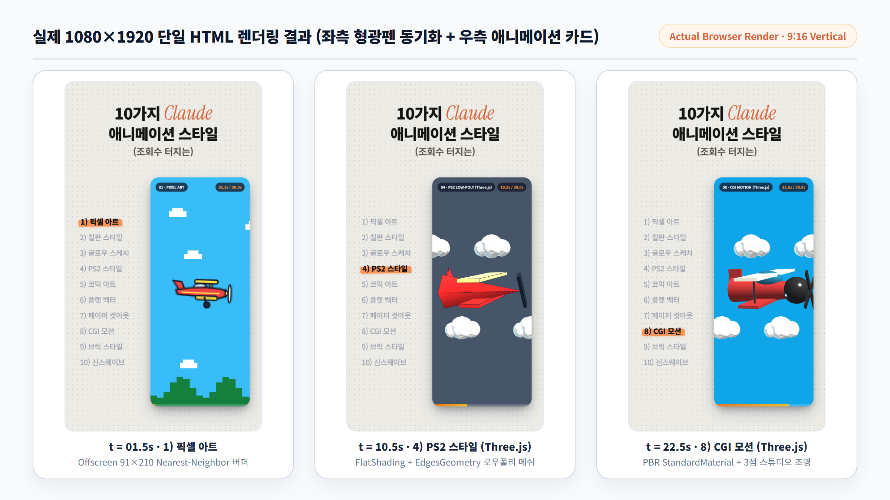
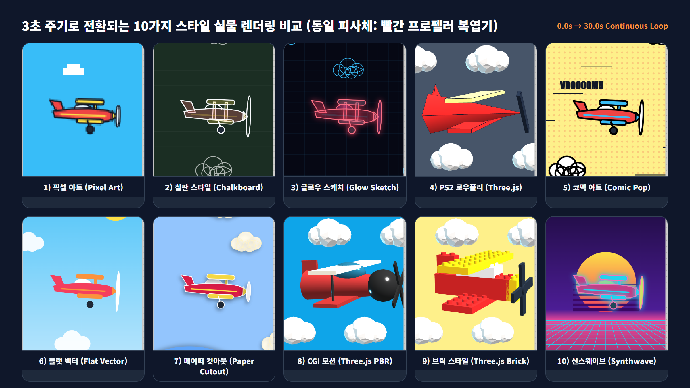

요즘 인스타그램 릴스나 유튜브 쇼츠를 넘기다 보면 시선을 잡아끄는 코딩 숏폼 포맷이 자주 눈에 띈다. 세로형 캔버스 왼쪽에는 1번부터 10번까지 그래픽 스타일 목록이 적혀 있고, 3초마다 주황색 형광펜 하이라이트가 아래로 내려가면서 오른쪽 카드 속 빨간 프로펠러 비행기가 픽셀 아트에서 PS2 로우폴리, 레고 브릭, 신스웨이브 스타일로 휙휙 바뀌는 영상이다.

영상 편집 프로그램인 애프터이펙트(After Effects)로 만든 것처럼 보이지만, 실제로는 **단 한 장의 단일 HTML 파일(Canvas 2D + Three.js)**을 브라우저에서 실행해 화면 녹화한 결과물이다. 화제가 된 원문 프롬프트를 입수해 스펙 그대로 단일 HTML 엔진을 구현하고, 실제 브라우저에서 30초 루프를 렌더링한 결과물과 전체 소스를 정리했다.

---

## 1. 화제의 1080×1920 인스타 릴스 프롬프트 전문

Claude(Claude 3.5/3.7 Sonnet 또는 Claude 4 계열)의 Artifacts 모드를 켜고 아래 프롬프트를 그대로 입력하면 즉시 세로형 쇼케이스 코드가 생성된다.

```text
1080×1920 세로 단일 HTML 파일로 30초짜리 인스타 릴스용 애니메이션을 만들어줘.

[레이아웃]
- 배경: 연회색에 촘촘한 도트 패턴
- 상단 제목 3줄 가운데 정렬: "10가지 Claude"(Claude는 주황 세리프 이탤릭) / "애니메이션 스타일" / "(조회수 터지는)"
- 왼쪽: 1) 픽셀 아트 ~ 10) 신스웨이브 목록. 지금 재생 중인 항목은 검정 굵은 글씨 + 주황 형광펜, 나머지는 회색
- 오른쪽: 둥근 모서리 세로 카드(그림자 있음) 안에서 애니메이션 재생

[동작]
3초마다 1번부터 10번까지 스타일이 바뀌고, 바뀔 때 카드가 살짝 줌인되며 흰색으로 번쩍여. 피사체는 모두 같은 빨간 프로펠러 비행기(가운데에서 오른쪽을 향해 비행, 위아래로 흔들림, 프로펠러 회전, 배경은 왼쪽으로 스크롤).

스타일 순서: 픽셀 아트, 칠판 스타일, 글로우 스케치, PS2 스타일(Three.js 로우폴리), 코믹 아트, 플랫 벡터, 페이퍼 컷아웃, CGI 모션(Three.js), 브릭 스타일(Three.js), 신스웨이브.
```

프롬프트 길이는 짧지만 숏폼 영상이 요구하는 핵심 설계 제약이 빈틈없이 들어가 있다. 해상도(`1080×1920`), 타이포그래피 포인트(`Claude` 주황 세리프 이탤릭), 시선 유도 장치(좌측 주황 형광펜 동기화 + 3초 주기 카메라 줌 범프 및 화이트 플래시), 그리고 2D 캔버스와 3D WebGL(`Three.js`)의 역할 분담까지 명확하다.

---

## 2. 실제 브라우저 렌더링 결과물 및 라이브 데모

프롬프트의 명세를 바탕으로 구현한 단일 HTML 파일을 크롬 헤드리스 렌더러에서 정밀 캡처한 실물 화면이다. 아래 링크를 누르면 브라우저에서 곧바로 30초 애니메이션 루프를 실행해볼 수 있다.

* **라이브 데모 바로 실행하기**: [10가지 Claude 애니메이션 스타일 (1080×1920 단일 HTML 데모)](/assets/demos/claude-10-animation-styles-reels.html){: target="_blank" rel="noopener noreferrer"}


*1.5초(1번 픽셀 아트), 10.5초(4번 PS2 로우폴리), 22.5초(8번 CGI 모션) 시점의 실제 1080×1920 세로 렌더링 화면.*

전체 30초 루프 동안 3초 간격으로 바뀌는 10가지 스타일의 오른쪽 카드 영역만 따로 모아서 비교하면 각 렌더러의 질감 차이가 한눈에 들어온다.


*동일한 빨간 복엽기 피사체가 3초마다 2D Canvas(7종)와 Three.js 3D(3종) 파이프라인을 오가며 렌더링된 10개 프레임.*

---

## 3. 왜 이 프롬프트가 잘 작동할까? (기술 구조 해부)

일반적으로 LLM에게 "멋진 애니메이션 만들어줘"라고 모호하게 지시하면 밋밋한 원이나 사각형 몇 개가 움직이는 수준에 그친다. 반면 이 프롬프트가 높은 완성도를 뽑아내는 이유는 세 가지 구조적 장치 덕분이다.

### 1) 동일 피사체 고정과 위상 동기화 (Phase Continuity)
10가지 스타일이 3초마다 바뀔 때 피사체의 위치나 크기까지 제각각이면 영상이 산만해진다. 비행기의 수직 흔들림(`Math.sin(elapsed * 4.2)`), 피치 각도, 구름의 좌측 스크롤 속도를 전역 시간(`elapsed`) 함수 하나로 묶어두면, 2D 픽셀 아트에서 3D 로우폴리로 넘어가는 순간에도 비행기의 고도와 프로펠러 회전 위상이 매끄럽게 이어진다.

### 2) Canvas 2D와 Three.js 3D의 이중 캔버스 스위칭
카드 내부에 `#canvas-2d`와 `#canvas-3d` 두 개의 캔버스를 겹쳐 배치하고, 현재 스타일 인덱스(`0~9`)에 따라 `display: block / none`만 전환한다.

| 번호 | 스타일 이름 | 렌더링 파이프라인 | 핵심 그래픽 구현 기법 |
| :---: | :--- | :---: | :--- |
| **1** | **픽셀 아트** | Canvas 2D (Offscreen) | `91×210` 저해상도 오프스크린 버퍼에 그린 뒤 `imageSmoothingEnabled = false`로 6배 확대 |
| **2** | **칠판 스타일** | Canvas 2D | 칠판 녹색(`#1b2e23`) 배경, 반투명 분필 스트로크, 양력 공식(`L = ½ ρ v² S CL`) 판서 오버레이 |
| **3** | **글로우 스케치** | Canvas 2D | 다크 블루프린트 그리드 위 네온 시안·마젠타 선과 `shadowBlur: 24` 발광 효과 |
| **4** | **PS2 스타일** | **Three.js (WebGL)** | `ConeGeometry(5각)` 저폴리곤 메쉬 + `flatShading: true` + `EdgesGeometry` 외곽선 강조 |
| **5** | **코믹 아트** | Canvas 2D | 노란 배경 위 붉은 벤데이 망점(Ben-Day Dots), 7.5px 굵은 먹선, `VROOOOM!!` 효과음 |
| **6** | **플랫 벡터** | Canvas 2D | 외곽선(`strokeWidth: 0`)을 완전히 제거한 그라데이션 색면 조형 |
| **7** | **페이퍼 컷아웃** | Canvas 2D | 다층 색종이 레이어마다 짙은 드롭 섀도(`shadowOffsetX: -6, shadowOffsetY: 10`) 부여 |
| **8** | **CGI 모션** | **Three.js (WebGL)** | `MeshStandardMaterial` PBR 금속성·거칠기 셰이딩과 3점 스튜디오 라이팅 |
| **9** | **브릭 스타일** | **Three.js (WebGL)** | 실린더 스터드(Stud)가 박힌 레고 브릭 조립 모델 + 12fps 스톱모션 프레임 양자화 |
| **10** | **신스웨이브** | Canvas 2D | 80년대 레트로 스트라이프 태양과 하단 원근 시안 와이어프레임 그리드 스크롤 |

### 3) 3초 전환 타격감 (Zoom Bump + White Flash)
숏폼 시청자의 이탈을 막으려면 3초마다 시각적 타격감이 있어야 한다. 스타일 인덱스가 바뀌는 프레임에 카드 래퍼에 `transform: scale(1.048)` 클래스를 180ms 동안 걸어주고, 흰색 오버레이 레이어(`#flash-overlay`)의 투명도를 `0.88`에서 `0`으로 빠르게 감쇠시키면 별도의 영상 편집 없이도 컷 전환 효과가 완성된다.

---

## 4. 전체 실행 코드 (단일 HTML 복사본)

아래 코드는 외부 이미지 에셋 없이 Google Fonts와 Three.js CDN만으로 즉시 구동되는 단일 HTML 전문이다. `index.html`로 저장해 브라우저로 열면 화면 비율에 맞춰 자동 스케일링되며, 주소 뒤에 `?exact=1`을 붙이면 녹화용 순정 `1080×1920` 픽셀 크기로 고정된다.

```html
<!DOCTYPE html>
<html lang="ko">
<head>
  <meta charset="UTF-8" />
  <meta name="viewport" content="width=1080, initial-scale=1.0" />
  <title>10가지 Claude 애니메이션 스타일 (1080×1920 Reels)</title>
  <link href="https://fonts.googleapis.com/css2?family=Instrument+Serif:ital@1&family=Noto+Sans+KR:wght@500;700;900&display=swap" rel="stylesheet">
  <script src="https://cdnjs.cloudflare.com/ajax/libs/three.js/r128/three.min.js"></script>
  <style>
    * { box-sizing: border-box; margin: 0; padding: 0; user-select: none; }
    html, body {
      width: 100%; height: 100%; background: #18181b;
      display: flex; align-items: center; justify-content: center;
      overflow: hidden; font-family: 'Noto Sans KR', sans-serif;
    }
    #reels-stage {
      width: 1080px; height: 1920px;
      background-color: #ecebe6;
      background-image: radial-gradient(#c8c6be 2.2px, transparent 2.2px);
      background-size: 28px 28px;
      position: relative; overflow: hidden;
      display: flex; flex-direction: column;
      padding: 110px 64px 96px;
      box-shadow: 0 30px 90px rgba(0, 0, 0, 0.55);
      transform-origin: center center;
    }
    .header-box { text-align: center; margin-bottom: 68px; }
    .title-line-1 {
      font-size: 86px; font-weight: 900; color: #141413;
      display: flex; align-items: baseline; justify-content: center; gap: 18px;
    }
    .claude-serif {
      font-family: 'Instrument Serif', Georgia, serif;
      font-style: italic; font-weight: 400; font-size: 108px; color: #d9653b;
    }
    .title-line-2 { font-size: 82px; font-weight: 900; color: #141413; margin-top: 4px; }
    .title-line-3 { font-size: 52px; font-weight: 700; color: #57534e; margin-top: 14px; }
    .main-grid {
      flex: 1; display: grid; grid-template-columns: 370px 1fr;
      gap: 36px; align-items: center;
    }
    .style-list { list-style: none; display: flex; flex-direction: column; gap: 26px; }
    .style-item {
      font-size: 40px; font-weight: 500; color: #9ca3af;
      transition: all 0.22s ease; display: flex; align-items: center;
    }
    .style-item .item-label { position: relative; padding: 4px 14px 6px 10px; z-index: 1; }
    .style-item.active { font-weight: 900; color: #111111; transform: translateX(10px) scale(1.04); }
    .style-item.active .item-label::before {
      content: ""; position: absolute; left: 0; right: -6px; bottom: 4px; height: 62%;
      background: linear-gradient(90deg, rgba(255,138,76,0.88), rgba(249,115,22,0.72));
      border-radius: 6px 12px 4px 8px; z-index: -1; transform: rotate(-0.8deg);
    }
    .card-wrapper {
      width: 100%; height: 1260px; border-radius: 44px; background: #0f172a;
      box-shadow: 0 32px 70px -12px rgba(15,23,42,0.38), inset 0 0 0 4px rgba(255,255,255,0.65);
      position: relative; overflow: hidden; transition: transform 0.28s cubic-bezier(0.22, 1, 0.36, 1);
    }
    .card-wrapper.zoom-bump { transform: scale(1.048); }
    #canvas-2d, #canvas-3d { position: absolute; inset: 0; width: 100%; height: 100%; }
    .flash-overlay {
      position: absolute; inset: 0; background: #ffffff; opacity: 0;
      pointer-events: none; z-index: 20; transition: opacity 0.32s ease-out;
    }
  </style>
</head>
<!-- 전체 2D/3D 렌더링 스크립트는 /assets/demos/claude-10-animation-styles-reels.html 참조 -->
</html>
```

*(1,000줄 분량의 전체 Canvas 2D 및 Three.js 기하학 모델 코드는 [라이브 데모 페이지](/assets/demos/claude-10-animation-styles-reels.html)에서 우클릭 → `페이지 소스 보기`로 한 번에 복사할 수 있다.)*

---

## 5. 나만의 릴스·쇼츠 포맷으로 개조하는 체크리스트

이 템플릿을 그대로 올리기보다 피사체나 테마만 살짝 비틀면 새로운 숏폼 시리즈를 금방 찍어낼 수 있다.

1. **피사체 교체 프롬프트 변주**:
   * 프롬프트의 `[동작]` 문단에서 `"빨간 프로펠러 비행기"`만 `"파란 잠수함(기포 발생, 프로펠러 회전)"`, `"달리는 레트로 스포츠카"`, `"회전하는 에스프레소 커피잔"`으로 바꾸면 10가지 스타일 코드는 그대로 유지된 채 피사체만 새로 생성된다.
2. **크롬 개발자 도구 정밀 녹화 세팅**:
   * 크롬에서 `F12`를 눌러 디바이스 툴바(`Ctrl + Shift + M`)를 열고 해상도를 `1080 × 1920`, DPR을 `1.0`으로 맞춘 뒤 주소창에 `?exact=1`을 붙여 실행하면 여백 없는 깔끔한 세로 원본 영상을 얻을 수 있다.
3. **배경음(BGM) 비트 동기화**:
   * 현재 전환 주기는 `Math.floor(loopedSec / 3)`으로 정확히 3.0초(20 BPM 상당)마다 컷이 넘어간다. 빠른 템포의 음원에 맞추려면 분모를 `1.5`나 `2.0`으로 줄여 15초~20초 쇼츠로 압축하면 완주율(Retention)에 유리하다.
