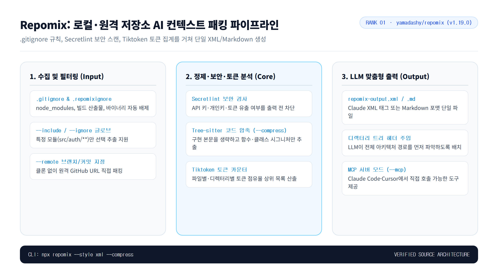
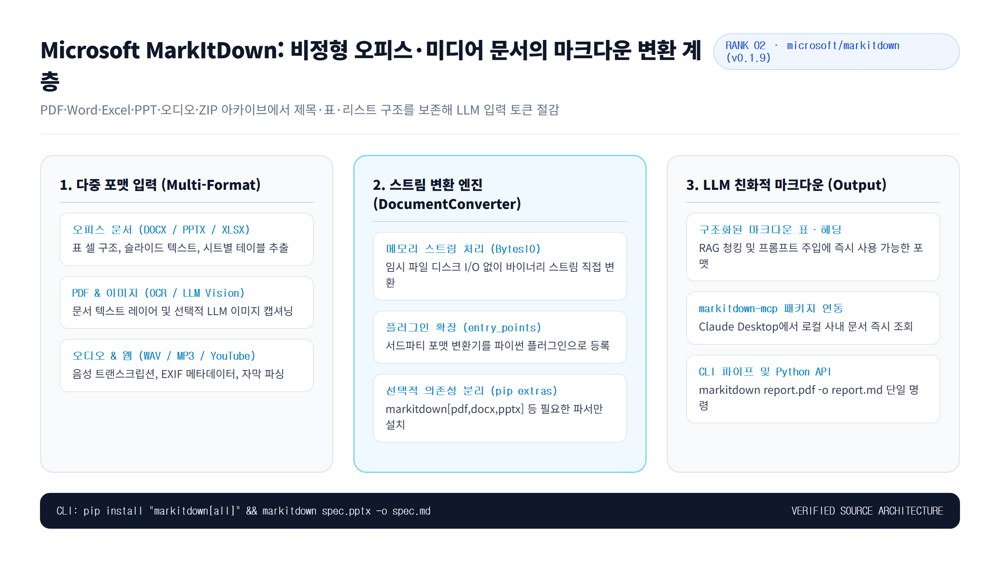
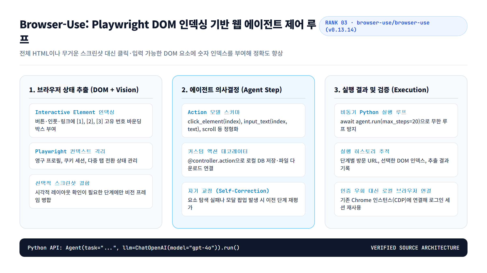
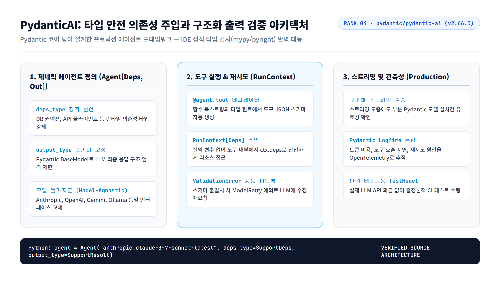
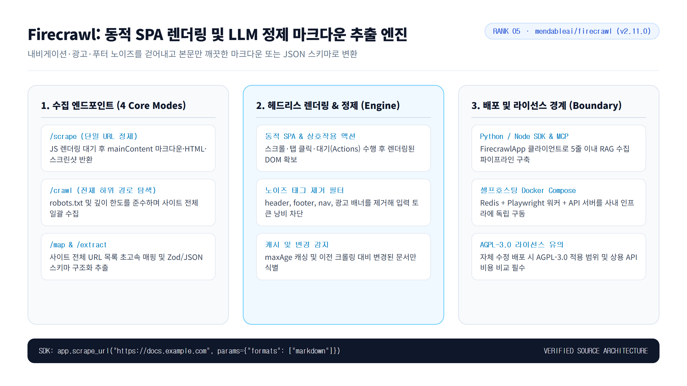

LLM 모델 자체의 추론 성능이 상향 평준화되면서 개발 현장의 병목은 다른 곳으로 이동했다. "모델이 얼마나 똑똑한가"보다 **"내 로컬 저장소, 사내 PDF 기획서, 동적 웹 페이지, 그리고 외부 API 도구를 얼마나 깨지지 않는 구조로 모델에게 먹여줄 것인가"**가 실제 생산성을 가른다.

이번 `#05`는 **2026년 11월 8일 KST 기준 GitHub API로 확인한 릴리스 스냅샷**을 바탕으로, 기존 `#01~#04` 시리즈에서 다루지 않았던 컨텍스트 엔지니어링 및 에이전트 런타임 오픈소스 5개를 선별했다. 프롬프트 장난감이나 일회성 데모는 걷어내고, 패키지 매니저(`npx`, `pip`, `uv`)로 즉시 설치해 오늘 당장 실무 워크플로에 끼워 넣을 수 있는 도구들이다.

---

## 2026-11-08 실용성 기준 TOP 5

| 순위 | 저장소 | 스냅샷 (Stars / Forks) | 라이선스 | 최신 릴리스 | 핵심 해결 과제 |
| ---: | --- | ---: | --- | --- | --- |
| **1위** | [yamadashy/repomix](https://github.com/yamadashy/repomix){: target="_blank" rel="noopener noreferrer"} | 29,186 / 1,631 | MIT | `v1.19.0` | 전체 코드베이스를 Secretlint 검사와 토큰 계산을 거쳐 단일 XML/MD 파일로 패킹한다 |
| **2위** | [microsoft/markitdown](https://github.com/microsoft/markitdown){: target="_blank" rel="noopener noreferrer"} | 194,388 / 14,637 | MIT | `v0.1.9` | PDF·PPTX·XLSX·DOCX·오디오 파일을 LLM 입력에 최적화된 마크다운 구조로 변환한다 |
| **3위** | [browser-use/browser-use](https://github.com/browser-use/browser-use){: target="_blank" rel="noopener noreferrer"} | 120,306 / 13,435 | MIT | `0.13.14` | Playwright DOM 요소에 숫자 인덱스를 부여해 LLM이 브라우저를 정밀 제어하게 만든다 |
| **4위** | [pydantic/pydantic-ai](https://github.com/pydantic/pydantic-ai){: target="_blank" rel="noopener noreferrer"} | 21,086 / 3,130 | MIT | `v2.66.0` | FastAPI 스타일 의존성 주입과 Pydantic 출력 검증으로 프로덕션 에이전트를 구축한다 |
| **5위** | [mendableai/firecrawl](https://github.com/mendableai/firecrawl){: target="_blank" rel="noopener noreferrer"} | 199,653 / 10,509 | AGPL-3.0 | `v2.11.0` | JS 렌더링이 필요한 동적 웹사이트 전체를 크롤링해 노이즈 없는 마크다운으로 뽑아낸다 |

> **선정 기준**: 기존 시리즈 중복 배제 → 오픈소스 라이선스 명시 → 최신 릴리스 및 커밋 활성도(2026년 11월 첫째 주 푸시 확인) → 로컬 CLI 또는 SDK 재현성 순서로 검증했다.

---

## 1위. Repomix (`yamadashy/repomix`)

```text
저장소  yamadashy/repomix
형태    코드베이스 AI 컨텍스트 패커 CLI 및 MCP 서버
언어    TypeScript (MIT)
현재성  릴리스 v1.19.0, 2026-11-08 커밋 확인
```



Claude나 ChatGPT 웹 인터페이스에 아키텍처 리팩터링을 맡길 때 파일 수십 개를 일일이 복사해 붙여넣는 건 고역이다. `Repomix`는 프로젝트 루트에서 명령어 한 줄만 실행하면 `.gitignore` 규칙을 준수해 불필요한 빌드 산출물을 걸러내고, 전체 디렉터리 트리와 각 파일의 소스를 하나의 `repomix-output.xml` 또는 마크다운 파일로 묶어준다.

특히 마음에 드는 부분은 **Secretlint 내장 보안 검사와 Tree-sitter 기반 `--compress` 옵션**이다. 실수로 `.env`나 하드코딩된 API 키가 컨텍스트 파일에 섞여 나가는 것을 출력 단계에서 차단해주고, 토큰 한도가 빡빡할 때는 `--compress` 플래그로 함수 구현부는 생략한 채 클래스·함수 시그니처만 추출해 토큰 소모량을 크게 줄인다.

```bash
# 로컬 프로젝트 전체를 Claude 친화적인 XML 포맷으로 패킹
npx repomix --style xml

# 원격 저장소를 클론하지 않고 시그니처 압축 모드로 즉시 추출
npx repomix --remote yamadashy/repomix --compress --output repomix-summary.xml
```

**도입 전 → 후**: 관련 파일 10여 개를 수동으로 찾아 복붙하며 디렉터리 경로를 따로 설명하던 작업이, 디렉터리 트리 헤더와 파일별 Tiktoken 토큰 비중이 정리된 단일 아티팩트 생성으로 단순화된다.

**프로덕션 유즈케이스**

1. 레거시 마이크로서비스의 `src/domain/**` 경로만 `--include` 옵션으로 추출해 전체 도메인 모델의 순환 참조 여부를 리뷰할 때.
2. 오픈소스 라이브러리의 최신 릴리스 브랜치를 `--remote`로 즉시 덤프해 내부 마이그레이션 가이드를 작성할 때.

---

## 2위. Microsoft MarkItDown (`microsoft/markitdown`)

```text
저장소  microsoft/markitdown
형태    비정형 오피스·미디어 문서 마크다운 변환기
언어    Python (MIT)
현재성  릴리스 v0.1.9, 2026-11-07 커밋 확인
```



현업의 요구사항은 친절하게 마크다운으로 오지 않는다. 기획서는 `.pptx` 슬라이드에 들어 있고, 정산 내역은 `.xlsx` 다중 시트에, 계약서와 표준 규격은 `.pdf`나 `.docx`로 전달된다. 마이크로소프트 AutoGen 팀에서 시작해 독립 유틸리티로 발전한 `MarkItDown`은 이런 오피스 문서와 압축 파일(`.zip`), 오디오 메타데이터까지 **LLM이 가장 잘 읽는 마크다운 표와 헤딩 구조**로 일괄 변환한다.

무거운 풀스택 OCR 파이프라인과 달리 문서 내부의 네이티브 XML/DOM 트리를 직접 파싱하기 때문에 속도가 빠르고, 메모리 스트림(`BytesIO`) 기반으로 동작해 디스크에 임시 파일을 남기지 않는다. 필요한 파일 포맷만 골라서 의존성을 설치할 수 있도록 `markitdown[pdf,docx,pptx]`처럼 선택적 Extras 구조를 채택한 점도 깔끔하다.

```bash
# 전체 포맷 파서 포함 설치 및 PPTX 기획서 마크다운 변환
pip install "markitdown[all]"
markitdown quarterly-architecture-review.pptx -o review.md
```

**문서 처리 전후 비교**: 엑셀 시트와 파워포인트 텍스트 상자를 수동으로 긁어다 프롬프트에 넣느라 표 열이 깨지던 상태에서, 마크다운 테이블 구문(`| col |`)과 계층형 제목이 보존된 정제 텍스트 파이프라인으로 전환된다.

**프로덕션 유즈케이스**

1. 사내 위키에 올라오는 주간 `.docx`/`.xlsx` 장애 보고서를 CI 배치로 변환해 RAG 벡터 DB의 청킹 입력 소스로 넣을 때.
2. `markitdown-mcp` 서버를 Claude Desktop에 연결해 로컬 폴더의 PDF 기술 규격서를 대화형으로 대조할 때.

---

## 3위. Browser-Use (`browser-use/browser-use`)

```text
저장소  browser-use/browser-use
형태    Playwright DOM 인덱싱 기반 웹 에이전트 프레임워크
언어    Python (MIT)
현재성  릴리스 0.13.14, 2026-11-08 커밋 확인
```



웹 자동화 에이전트를 만들 때 흔히 부딪히는 벽은 두 가지다. 생짜 HTML DOM 전체를 LLM에 넘기면 수만 토큰이 순식간에 증발하고, 반대로 화면 캡처(Vision) 좌표에만 의존하면 버튼 위치가 몇 픽셀만 어긋나도 클릭이 빗나간다.

`Browser-Use`는 Playwright 위에서 현재 화면의 상호작용 가능한 요소(버튼, 입력창, 드롭다운)만 추려내어 **`[1]`, `[2]`, `[3]` 같은 고유 숫자 인덱스와 바운딩 박스를 매핑**한다. LLM은 복잡한 XPath나 CSS 셀렉터를 추측할 필요 없이 `"3번 인덱스에 검색어를 입력하고 5번 인덱스를 클릭하라"`는 정형 액션만 반환하면 된다.

```bash
# uv 환경에서 browser-use 및 Chromium 런타임 설치
uv pip install browser-use
playwright install chromium
```

**자동화 구조 변화**: UI 클래스명이 바뀔 때마다 깨지던 하드코딩 Playwright 셀렉터 스크립트에서, DOM 인덱스 기반으로 모달 닫기나 페이지네이션 이동을 스스로 판단하는 에이전트 루프로 바뀐다. 다만 캡차(CAPTCHA)나 2단계 인증이 걸린 페이지는 여전히 사람의 세션 연결(CDP)이 필요하다.

**프로덕션 유즈케이스**

1. 공식 API를 제공하지 않는 레거시 관리자 포털에서 매일 아침 정산 내역 테이블을 조회해 로컬 CSV로 내려받는 백오피스 자동화.
2. 스테이징 배포 직후 주요 사용자 시나리오(회원가입 → 장바구니 담기 → 결제창 진입)가 정상 작동하는지 검증하는 자율 QA 에이전트.

---

## 4위. PydanticAI (`pydantic/pydantic-ai`)

```text
저장소  pydantic/pydantic-ai
형태    타입 안전 에이전트 및 구조화 검증 프레임워크
언어    Python (MIT)
현재성  릴리스 v2.66.0, 2026-11-08 커밋 확인
```



파이썬 생태계의 표준 검증 라이브러리인 Pydantic 코어 팀이 직접 만든 에이전트 프레임워크다. 거대한 추상화 계층으로 악명 높은 기존 프레임워크들과 달리, FastAPI를 써본 개발자라면 10분 만에 이해할 수 있는 **명시적 타입 힌트(`Agent[DepsT, OutputT]`)와 의존성 주입(`RunContext`)**을 전면에 내세웠다.

가장 강력한 무기는 **자기 교정(Self-Correction) 루프와 정적 타입 검사기(`mypy`, `pyright`) 호환성**이다. `@agent.tool`로 등록한 함수에 주입되는 DB 커넥션 타입이 틀리면 런타임 전에 IDE에서 즉시 빨간 줄이 뜨고, LLM이 반환한 JSON이 `output_type` Pydantic 모델 검증에 실패하면 프레임워크가 오류 메시지를 담아 LLM에 자동으로 재시도(`ModelRetry`)를 요청한다.

```bash
# 기본 설치 또는 슬림 패키지(선택적 모델 의존성) 설치
pip install pydantic-ai
# Anthropic 모델만 단독 사용할 경우
pip install "pydantic-ai-slim[anthropic]"
```

**서비스 계층 변화**: 프롬프트 끝에 "반드시 JSON으로만 답해줘"라고 적고 정규식으로 파싱하다 런타임 에러를 겪던 코드가, 스키마 검증과 재시도·단위 테스트(`TestModel`)까지 보장되는 타입 안전 서비스 계층으로 격상된다.

**프로덕션 유즈케이스**

1. 고객 문의 티켓을 분석해 환불 가능 여부, 위험 등급(`int`), 근거 규정 조항을 엄격한 Pydantic 스키마로 반환해야 하는 백엔드 API.
2. 실제 LLM 과금 없이 CI 파이프라인에서 에이전트의 도구 호출 분기 로직을 결정론적으로 검증해야 할 때.

---

## 5위. Firecrawl (`mendableai/firecrawl`)

```text
저장소  mendableai/firecrawl
형태    LLM 특화 웹 스크래핑·크롤링 및 구조화 추출 엔진
언어    TypeScript / Python SDK (AGPL-3.0)
현재성  릴리스 v2.11.0, 2026-11-08 커밋 확인
```



외부 기술 문서나 경쟁사 릴리스 노트를 수집해 RAG 시스템을 구축할 때 `curl`이나 단순 `BeautifulSoup`만으로는 한계가 뚜렷하다. CSR(클라이언트 사이드 렌더링)로 돌아가는 SPA 페이지는 빈 껍데기만 내려오고, 어렵게 HTML을 긁어와도 상단 내비게이션 바와 푸터 링크가 본문보다 더 많은 토큰을 잡아먹는다.

`Firecrawl`은 헤드리스 브라우저 렌더링과 본문 정제 필터를 결합해 **`/scrape`(단일 페이지), `/crawl`(하위 경로 전체), `/map`(사이트 URL 지도 생성), `/extract`(스키마 기반 JSON 추출)** 네 가지 모드를 제공한다. 단, 오픈소스 저장소 라이선스가 **AGPL-3.0**이므로 사내에서 소스를 수정해 외부 서비스로 재배포할 때는 라이선스 전파 조건을 반드시 따져봐야 한다.

```bash
# Python SDK 설치 및 공식 문서 사이트 마크다운 추출 예시
pip install firecrawl-py
```

```python
from firecrawl import FirecrawlApp

app = FirecrawlApp(api_key="fc-YOUR_API_KEY") # 또는 자체 호스팅 로컬 엔드포인트
result = app.scrape_url("https://docs.astro.build", params={"formats": ["markdown"]})
print(result["markdown"][:500])
```

**수집 파이프라인 변화**: 사이트마다 다른 DOM 태그(`nav`, `aside`, `footer`)를 걷어내는 커스텀 파서를 매번 짜던 수고가, 단일 API 호출로 본문 마크다운만 깔끔하게 받아오는 표준 수집 단계로 줄어든다.

**프로덕션 유즈케이스**

1. 프레임워크 공식 문서 사이트 전체를 `/crawl`로 순회해 최신 버전 문서를 로컬 코딩 에이전트의 지식 베이스로 동기화할 때.
2. `/map` 엔드포인트로 대상 도메인의 전체 URL 구조를 빠르게 뽑아낸 뒤 변경된 기술 공지 페이지만 선별 스크래핑할 때.

---

## 어떤 도구부터 도입할까? (선택 가이드)

다섯 프로젝트 모두 "LLM과 외부 세계의 인터페이스"를 다루지만 도입 시점은 명확히 갈린다.

* **오늘 당장 설정 없이 1분 만에 효과를 보려면**: 설치조차 필요 없는 `npx repomix`와 `pip install "markitdown[all]"` 조합이 가장 확실하다. 로컬 코드와 사내 오피스 문서를 깔끔한 텍스트로 바꾸는 것만으로도 답변 품질이 달라진다.
* **외부 웹 데이터를 수집하거나 조작해야 한다면**: 정적·동적 문서 수집이 목적이면 `Firecrawl`을, 로그인 뒤 버튼을 누르고 폼을 제출하는 워크플로가 목적이면 `Browser-Use`를 선택한다.
* **에이전트를 사내 정식 프로덕션 API로 배포한다면**: 임시 프롬프트 체인을 걷어내고 `PydanticAI`로 입출력 스키마와 의존성 주입 구조부터 고정하는 편이 유지보수 비용을 아끼는 길이다.
