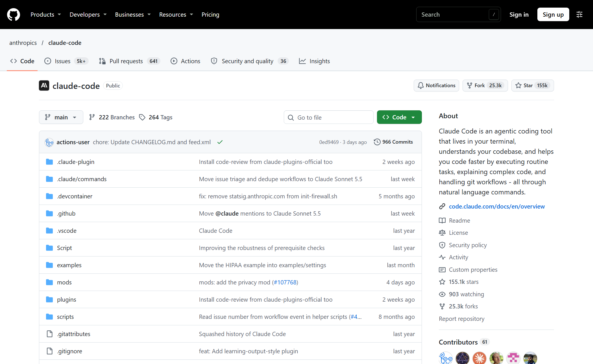
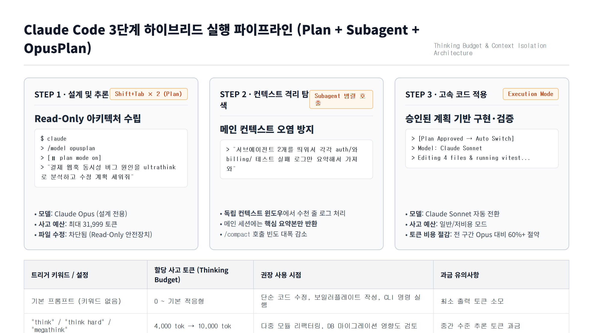

클로드 코드(Claude Code)를 터미널에서 쓰다 보면 똑같은 모델인데도 어떤 날은 복잡한 비동기 버그를 단번에 짚어내고, 어떤 날은 파일만 이리저리 고치다 테스트를 깨뜨리는 경우를 보게 된다. 모델이 갑자기 멍청해진 게 아니라 **해당 턴에 할당된 내부 사고 예산(Extended Thinking Budget)과 실행 모드**가 달랐기 때문이다.

클로드 코드는 프롬프트에 포함된 특정 영어 키워드(`think` → `think hard` → `ultrathink`)를 감지해 단일 턴의 추론 토큰 한도를 **4,000 토큰에서 최대 31,999 토큰**까지 단계별로 끌어올린다. 여기에 `Shift+Tab` 두 번으로 켜는 **Plan 모드(읽기 전용 설계)**와 **`/model opusplan`**, 그리고 **서브에이전트(Subagent) 병렬 탐색**을 묶어 쓰면 토큰 한도(Rate Limit)를 아끼면서도 설계 품질을 극대화할 수 있다. 공식 문서와 CLI 동작 사양을 바탕으로 핵심 워크플로우를 정리해 보자.

---

## 1. 프롬프트 한 단어로 갈리는 사고 예산: `think`부터 `ultrathink`까지

앤트로픽(Anthropic)의 Claude Code CLI는 사용자의 자연어 프롬프트 안에 들어 있는 추론 트리거 단어를 파싱해 API 호출 시 `thinking.budget_tokens` 값을 동적으로 조정한다.


*공식 `anthropics/claude-code` 저장소. 터미널 기반 에이전트 루프에서 추론 깊이(Thinking Budget)와 권한 모드(Permission Mode)를 조합해 동작한다.*

단순히 기분 내키는 대로 강조 표현을 쓰는 게 아니라, 클로드 코드 내부 어휘 매퍼에 정의된 **4단계 추론 계층**이 명확히 존재한다.

| 단계 | 프롬프트 트리거 키워드 | 할당 사고 예산 (`budget_tokens`) | 권장 작업 난이도 및 용도 |
| :--- | :--- | :--- | :--- |
| **Level 0 (기본)** | 트리거 키워드 없음 | 기본 적응형 (최소 추론) | 단순 함수 수정, 정규식 작성, 린트 에러 수정, 짧은 쉘 명령 |
| **Level 1 (기본 사고)** | `think` | **약 4,000 토큰** | 단일 파일 리팩터링, 컴포넌트 Props 구조 정리, 단위 테스트 케이스 도출 |
| **Level 2 (중간 사고)** | `think hard`, `megathink`, `think deeply` | **약 10,000 토큰** | 3~5개 파일이 얽힌 의존성 변경, DB 스키마 마이그레이션 영향도 검토 |
| **Level 3 (울트라 모드)** | `think harder`, **`ultrathink`**, `think intensely` | **최대 31,999 토큰** | 대규모 아키텍처 설계, 레이스 컨디션(Race Condition) 추적, 교착 상태 원인 분석 |

여기서 핵심은 두 가지다.

1. **키워드는 반드시 영어로 넣어야 안전하다**: 한국어로 프롬프트를 작성하더라도 문장 끝에 `"ultrathink로 원인부터 분석해줘"`처럼 영문 키워드 `ultrathink`를 명시하는 편이 가장 확실하다.
2. **Thinking 토큰은 전부 Output 토큰으로 과금·집계된다**: `ultrathink`를 매 턴 습관처럼 붙이면 사소한 오타를 고칠 때도 최대 31,999 토큰의 추론 예산을 열어두게 되어 Pro/Max 플랜의 주간 사용량 한도나 API 비용이 순식간에 녹아내린다.

만약 키워드와 무관하게 세션 전체의 사고 토큰 상한선을 고정하고 싶다면 환경 변수 `MAX_THINKING_TOKENS`나 `/effort` 명령을 사용할 수 있다.

```bash
# 단일 세션에서 사고 토큰 한도를 16,000 토큰으로 명시적 지정
export MAX_THINKING_TOKENS=16000
claude

# 또는 Claude Code 대화창 내부에서 추론 강도 조절
/effort high
```

---

## 2. 왜 `ultrathink`는 반드시 Plan 모드(`Shift+Tab`)와 같이 써야 할까?

`ultrathink`만 단독으로 던졌을 때 가장 흔히 겪는 사고는 **"깊게 생각하긴 했는데, 내 의도와 다른 방향으로 파일 10개를 한꺼번에 고쳐버리는 것"**이다. 클로드 코드가 기본 실행 모드(또는 Auto-Edit 모드)에 있으면 추론이 끝나자마자 곧바로 파일 쓰기(`Edit`, `Write`) 도구부터 호출하기 때문이다.

이 문제를 원천 차단하는 공식 워크플로우가 **Plan 모드(`Shift+Tab` × 2 또는 `/plan`)**다.


*설계 단계(Plan Mode + Opus + ultrathink), 탐색 단계(Subagent 컨텍스트 격리), 구현 단계(Sonnet 자동 전환)를 분리한 3단계 워크플로우.*

### 단계별 실행 루프

1. **`Shift+Tab` 두 번 눌러 Plan 모드 진입 (`⏸ plan mode on`)**
   - 터미널 입력창 하단 상태 표시줄이 `⏸ plan mode on`으로 바뀐다(또는 `/plan` 슬래시 명령 입력).
   - 이 상태에서는 클로드 코드의 파일 수정 및 파괴적 쉘 명령 권한이 물리적으로 잠긴다. 오직 코드베이스를 읽고(`Read`, `Grep`, `Glob`) 설계도만 작성할 수 있다.
2. **설계 턴에만 `ultrathink` 투입**
   - 파일이 멋대로 바뀔 걱정이 없으므로, 이때 가장 무거운 질문을 던진다.
   ```text
   현재 서브모듈 배포 스크립트와 publish-quality-gate.mjs 사이의 해시 검증 불일치 원인을 찾고 싶어.
   관련 파일들을 먼저 읽고, 부작용 없는 수정 순서를 단계별로 계획해줘. ultrathink
   ```
3. **계획 검토 및 피드백 후 실행 모드 전환**
   - 클로드가 제시한 변경 대상 파일 목록과 엣지 케이스 분석을 읽고, 마음에 들지 않는 부분이 있으면 Plan 모드 상태에서 바로 수정 지시를 내린다.
   - 계획이 확정되면 `Shift+Tab`을 눌러 실행 모드로 풀고 `"이 계획대로 구현하고 테스트 돌려줘"`라고 지시한다. 이때는 이미 정답지가 나와 있으므로 `ultrathink` 없이도 빠르고 정확하게 코드를 작성한다.

---

## 3. 토큰 가성비의 끝판왕: `/model opusplan`과 서브에이전트(Subagent) 격리

설계는 가장 똑똑한 모델(Opus)로 하고 싶지만, 실제 코드 타이핑까지 Opus로 돌리면 토큰 소모가 부담스럽다. 앤트로픽이 이를 위해 공식 지원하는 모델 별칭(Alias)이 바로 **`opusplan`**이다.

```text
# Claude Code 프롬프트 창에서 입력
/model opusplan
```

`/model opusplan`을 켜두면 클로드 코드가 현재 모드에 따라 모델을 자동으로 갈아끼운다:
- **Plan 모드(`⏸ plan mode on`)일 때**: 자동으로 **Claude Opus** 모델을 호출해 아키텍처 추론과 복합 디버깅을 수행한다.
- **일반 실행 모드(코드 작성·수정)로 넘어갈 때**: 자동으로 **Claude Sonnet** 모델로 전환해 승인된 계획서를 바탕으로 빠르게 코드를 수정하고 테스트를 돌린다.

### 서브에이전트(Subagent)로 메인 컨텍스트 오염 막기

여기에 하나 더 조합하면 좋은 습관이 **서브에이전트 위임**이다. 클로드 코드에서 수십 개 파일을 뒤지거나 수천 줄짜리 빌드 에러 로그를 메인 대화창에서 직접 읽게 하면, 순식간에 컨텍스트 윈도우가 차올라 `/compact`를 연발하게 된다.

대신 탐색 작업을 서브에이전트로 분리해 지시하면 메인 세션의 컨텍스트를 깨끗하게 지킬 수 있다:

```text
서브에이전트를 사용해서 scripts/ 디렉토리 안의 모든 .mjs 파일에서
SHA-256 해시를 계산하는 함수 위치와 줄 번호만 조사해서 표로 요약해 와.
원본 파일 전체 내용은 메인 컨텍스트에 풀지 마.
```

이렇게 지시하면 서브에이전트가 독립된 자식 컨텍스트 윈도우 안에서 파일 수십 개를 읽고 필터링한 뒤, 메인 대화창에는 **깔끔하게 압축된 결과 요약본만 반환**하고 사라진다.

---

## 4. 실전 도입 의사결정 체크리스트

오늘부터 터미널에서 Claude Code를 켤 때 바로 적용할 수 있는 상황별 판단 기준이다.

- **파일 1~2개 내의 명확한 기능 추가·버그 수정인가?**
  - 일반 모드(Sonnet) + 트리거 키워드 없음 (가장 빠르고 토큰 소모 최소)
- **3개 이상 모듈이 얽혀 있거나 어디서 버그가 나는지부터 찾아야 하는가?**
  - `/model opusplan` 설정 → `Shift+Tab`으로 **Plan 모드** 진입 → 프롬프트 끝에 **`think hard`** 또는 **`ultrathink`** 추가
- **코드베이스 전체에서 특정 패턴을 찾거나 긴 테스트 로그를 분석해야 하는가?**
  - 메인 에이전트가 직접 읽지 말고 **"서브에이전트를 띄워서 요약만 가져오라"**고 지시해 메인 컨텍스트 보존
- **설계와 수정 작업이 한 단락 끝났는가?**
  - 다음 주제로 넘어가기 전에 `/clear`로 세션을 비우거나 `/compact`에 핵심 보존 지침을 함께 넘겨 컨텍스트 비용 초기화

무작정 모든 프롬프트에 `ultrathink`를 붙이는 건 스포츠카를 타고 동네 골목길에서 1단 기어로 풀악셀을 밟는 것과 같다. **Plan 모드 + `opusplan` + 결정적인 설계 턴의 `ultrathink` 한 방**으로 아끼고 집중하는 쪽이 훨씬 쾌적하다.

---

## 참고 자료 및 공식 출처

- [Anthropic Claude Code Documentation — Common Workflows (Plan Mode & Extended Thinking)](https://docs.anthropic.com/en/docs/claude-code/common-workflows)
- [Anthropic Claude Code Documentation — Model Configuration (`opusplan` & Effort Levels)](https://docs.anthropic.com/en/docs/claude-code/model-config)
- [Anthropic Official Repository — `anthropics/claude-code`](https://github.com/anthropics/claude-code)
