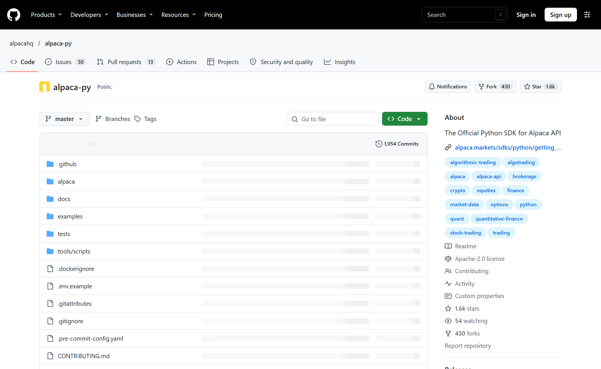
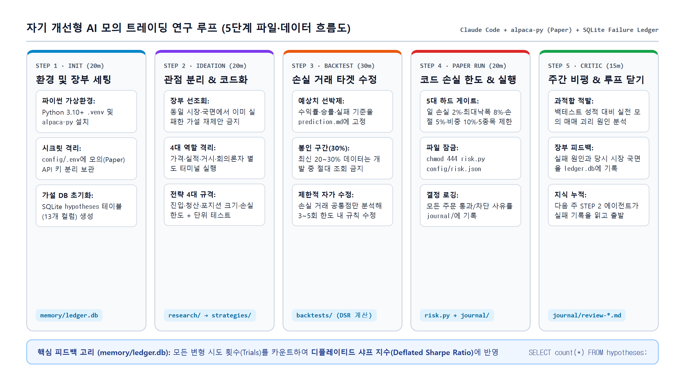
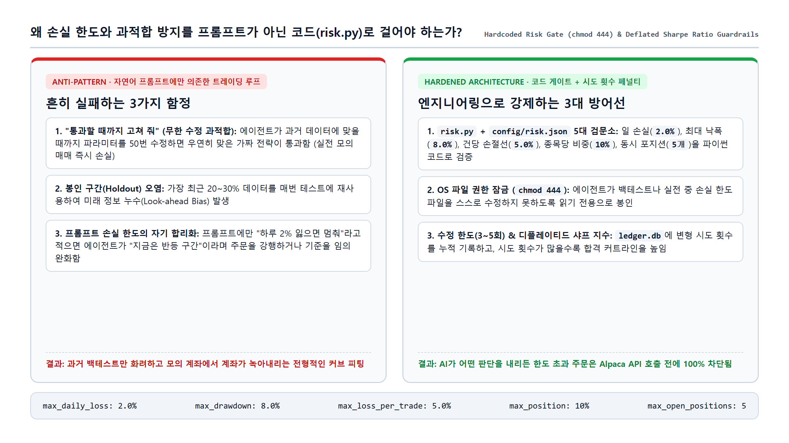

AI 코딩 에이전트에게 "수익 나는 자동매매 코드 좀 짜줘"라고 시켜본 개발자라면 결말을 이미 알고 있을 것이다. 처음에는 그럴듯한 이동평균선 교차 전략을 뽑아오지만, 백테스트를 돌려보면 처참하게 깨진다. 거기서 "통과할 때까지 파라미터 고쳐 봐"라고 지시하는 순간 재앙이 시작된다. 에이전트가 과거 차트에 억지로 끼워 맞춘 과적합(Curve-fitting) 괴물을 만들어 오고, 정작 실시간 장에 넣으면 첫날부터 계좌가 녹아내린다.

문제는 AI의 코딩 실력이 아니라 **루프(Loop)의 설계**에 있다. 진짜 퀀트 연구소처럼 에이전트를 굴리려면 ① 이미 실패한 아이디어를 기억하는 **SQLite 실패 장부(`memory/ledger.db`)**가 있어야 하고, ② 미래 데이터를 훔쳐보지 못하게 **최근 20~30% 구간을 봉인(Holdout)**해야 하며, ③ 백테스트에서 **돈을 잃은 거래만 골라 최대 3~5회 안에서만 규칙을 수정**하게 묶어야 한다. 무엇보다 손실 한도는 프롬프트 부탁이 아니라 에이전트가 읽기 전용(`chmod 444`)으로 잠긴 파이썬 검문소 파일(`risk.py`)로 강제해야 한다.

이번 글에서는 **클로드 코드(Claude Code)**와 미국 주식·ETF 무료 모의 투자 API인 **알파카(`alpacahq/alpaca-py` v0.45.0)**를 연결해, 손실이 날 때마다 실패 원인을 장부에 기록하고 스스로 전략 코드를 다듬는 **5단계 AI 모의 트레이딩 연구 루프**를 처음부터 끝까지 구축해 본다.

> **엔지니어링 및 비투자 자문 안내**: 본 가이드는 클로드 코드(Claude Code)와 무료 모의 계좌(`Paper Trading`)를 활용한 소프트웨어 아키텍처·백테스트 검증 루프 구축 실습 자료다. 특정 종목이나 금융 상품에 대한 투자 권유가 아니며, 모든 실습은 가상 자금(`paper=True`) 환경에서만 진행한다.

---

## 한 번에 세팅하기: 클로드 코드 원샷 구축 프롬프트

단계별로 하나씩 뜯어보기 전에, 빈 프로젝트 폴더에서 클로드 코드에게 STEP 1부터 STEP 5까지의 뼈대와 스크립트를 한 번에 세팅하게 만드는 마스터 프롬프트부터 공유한다. 터미널에서 `claude`를 실행한 뒤 아래 프롬프트를 그대로 붙여넣으면 된다.

```text
돈 잃을 때마다 스스로 코드를 고치는 AI 모의 트레이딩 시스템을 만들 거야.
아래 5단계를 순서대로 진행해 줘.

1단계 — 프로젝트 구조와 실패 장부 세팅:
- 현재 폴더에 config, research, strategies, backtests, journal, memory 폴더를 만들어 줘.
- Python 가상환경(.venv)을 만들고 alpaca-py, pandas, numpy, scipy, python-dotenv를 설치해 줘.
- memory/ledger.db SQLite 데이터베이스를 만들고 hypotheses 테이블을 생성해 줘.
  컬럼: id, created_at, source, thesis, strategy_file, market_regime,
  in_sample_sharpe, out_of_sample_sharpe, deflated_sharpe, paper_pnl_pct,
  status, failure_reason, lesson
- config/.env 파일 템플릿을 만들고 내가 Alpaca 모의 계좌 API 키를 넣을 수 있게 안내해 줘.
  내가 키를 넣기 전까지는 다음 단계로 넘어가지 말고 기다려 줘.

2단계 — 첫 가설 생성과 전략 코드 작성:
- memory/ledger.db에 이미 실패로 기록된 가설이 있는지 먼저 확인해 줘.
- 가격 흐름, 실적/뉴스, 거시 환경 3가지 관점에서 매매 가설을 각각 1개씩 제안하고,
  회의론자 관점에서 가장 약한 가설 2개를 탈락시켜 최종 1개만 남겨 줘.
- 살아남은 가설을 strategies/ 폴더 아래 파이썬 전략 코드로 짜고,
  진입 조건, 청산 조건, 포지션 크기, 최대 허용 손실 4가지를 모두 포함해 줘.
- 단위 테스트도 같이 짜서 통과하는지 확인해 줘.

3단계 — 백테스트와 손실 거래 수정:
- 백테스트 전에 예상 샤프 지수, 예상 승률, 실패 기준을 backtests/ 폴더에 먼저 기록해 줘.
- 전체 데이터 중 가장 최근 30%는 봉인 구간으로 따로 빼 두고 건드리지 마.
- 앞쪽 70% 데이터로만 구간 쪼개 검증(walk-forward)을 돌리고, 수수료와 슬리피지를 반영해 줘.
- 기준에 못 미치면 돈 잃은 거래만 골라서 공통 원인을 분석하고 전략 코드를 고쳐 줘.
  수정은 최대 3번까지만 하고, 시도할 때마다 memory/ledger.db에 기록해 줘.
- 3번 안에 통과하면 봉인해 둔 최근 30% 데이터로 딱 한 번 최종 검증을 돌려 줘.

4단계 — 코드 손실 한도와 모의 매매 연결:
- config/risk.json과 risk.py를 만들어서 일 최대 손실 2%, 계좌 최대 낙폭 8%,
  건당 손절 5%, 종목당 최대 비중 10%, 동시 보유 최대 5종목 제한을 코드로 걸어 줘.
- 모든 주문이 Alpaca 모의 계좌로 나가기 전에 반드시 risk.py의 check_order()를 거치게 해 줘.
- 매매 결정과 주문 결과를 journal/ 폴더에 날짜별 마크다운으로 기록하는 실행 스크립트를 만들어 줘.

5단계 — 주간 사후 검토 스크립트:
- journal/ 기록과 백테스트 예상치를 비교해서 과적합 여부를 판정하고,
  실패 원인과 교훈을 memory/ledger.db에 업데이트하는 주간 검토 스크립트를 만들어 줘.

각 단계가 끝날 때마다 생성된 파일과 실행 결과를 보여 주고,
API 키 입력이나 파일 읽기 전용 잠금(chmod 444)처럼 내가 직접 해야 하는 작업이 있으면 멈추고 알려 줘.
```

---

## Quick Start: 5단계 구축 로드맵 요약

전체 시스템은 가설 제안부터 모의 매매, 주간 반성문 작성까지 정확히 다섯 단계로 맞물려 돌아간다.

1. **[STEP 1. 모의 계좌 프로젝트 만들기 (20분)](#step-1-모의-계좌-프로젝트-만들기--20분)** — 파이썬 가상환경에 공식 `alpaca-py` SDK를 설치해 모의 계좌를 연결하고, 실패한 전략을 영구 기록할 SQLite 장부(`memory/ledger.db`)를 초기화한다.
2. **[STEP 2. 아이디어를 전략 코드로 바꾸기 (20분)](#step-2-아이디어를-전략-코드로-바꾸기--20분)** — 가격·실적·거시·회의론자 4개 관점으로 아이디어를 걸러내고, 단위 테스트가 포함된 파이썬 전략 코드로 변환한다.
3. **[STEP 3. 백테스트하고 돈 잃은 거래만 고치기 (30분)](#step-3-백테스트하고-돈-잃은-거래만-고치기--30분)** — 최근 20~30% 데이터를 봉인한 상태에서 백테스트를 돌리고, 손실이 난 거래의 공통점만 짚어 최대 3~5회 안에서 전략을 스스로 수정하게 만든다.
4. **[STEP 4. 손실 한도를 코드로 걸고 모의 매매 돌리기 (20분)](#step-4-손실-한도를-코드로-걸고-모의-매매-돌리기--20분)** — 일일 손실 한도(2%)와 최대 낙폭(8%)을 `risk.py` 코드로 박아 넣고 `chmod 444`로 잠근 뒤 실시간 모의 매매를 가동한다.
5. **[STEP 5. 사후 검토하고 실패를 장부에 쌓기 (15분)](#step-5-사후-검토하고-실패를-장부에-쌓기--15분)** — 주말마다 비평가 세션을 띄워 모의 매매 성적과 백테스트 예상치를 대조하고, 실패 원인을 장부에 쌓아 다음 주 가설 생성에 반영한다.

---

## 시스템이 도는 순서와 아키텍처

일반적인 자동매매 봇은 '전략 실행 → 주문 전송'이라는 단선 구조에서 끝난다. 반면 자기 개선형 루프는 **데이터베이스(`memory/ledger.db`)를 매개로 한 피드백 고리**가 핵심이다.


*▲ 모의 계좌 연동과 시장 데이터 조회에 사용하는 공식 `alpacahq/alpaca-py` 저장소(v0.45.0, Apache-2.0 라이선스, GitHub 스타 1.6k). `paper=True` 옵션 하나로 실계좌와 동일한 실시간 주문·체결 파이프라인을 무료로 테스트할 수 있다.*

각 단계가 주고받는 입력·출력 파일과 소요 시간은 아래 표와 같다.

| 단계 | 핵심 역할 | 입력 데이터 / 파일 | 출력 산출물 | 예상 시간 |
| :--- | :--- | :--- | :--- | :--- |
| **STEP 1** | 모의 계좌 & 실패 장부 세팅 | Alpaca Paper API 키 | `config/.env`, `memory/ledger.db` | 20분 |
| **STEP 2** | 4인 관점 분리 & 전략 코드화 | `memory/ledger.db` (과거 실패 조회) | `research/*.md`, `strategies/*.py` | 20분 |
| **STEP 3** | 백테스트 & 손실 거래 타겟 수정 | `strategies/*.py`, 과거 시세 (70% 개발 / 30% 봉인) | `backtests/*_prediction.md`, 수정된 전략 | 30분 |
| **STEP 4** | 하드코딩 손실 한도 & 모의 매매 | 통과 전략 + `risk.py` (`chmod 444`) | 실시간 모의 주문, `journal/YYYY-MM-DD.md` | 20분 |
| **STEP 5** | 주간 비평 & 장부 피드백 | `journal/*.md` + `backtests/*.md` | `journal/review-*.md`, `ledger.db` 갱신 | 15분 |

이 다섯 단계가 실제 디렉터리와 SQLite 테이블 사이에서 어떻게 순환하는지 도식화하면 다음과 같다.


*▲ 5단계 자율 연구 루프 아키텍처. STEP 3에서 전략을 수정한 횟수(Trials)와 STEP 5에서 적발된 과적합 사유가 모두 `memory/ledger.db`에 누적되어 다음 주 STEP 2 에이전트의 출발점을 바꾼다.*

---

## STEP 1. 모의 계좌 프로젝트 만들기 — 20분

첫 단계의 목표는 두 가지다. 하나는 실제 돈이 단 1원도 들어가지 않는 **Alpaca 모의 계좌(Paper Account)**를 파이썬과 연결하는 것이고, 다른 하나는 앞으로 에이전트가 겪을 수많은 실패를 기록할 **SQLite 장부(`memory/ledger.db`)**를 만드는 것이다.

### 사전 준비물 점검

* **Python 3.10 이상**: 공식 `alpaca-py` 최신 버전(v0.45.0)은 Python 3.10 이상을 요구한다. 터미널에서 `python3 --version`으로 버전을 먼저 확인하자.
* **Claude Code**: 터미널에서 `claude --version`이 정상 출력되어야 한다.
* **Alpaca 모의 계좌 API 키**: Alpaca 공식 사이트에서 무료 계정을 만든 뒤, 좌측 상단 모드가 반드시 노란색 **Paper Trading(모의 투자)**인지 확인하고 API Key(`PK...`로 시작)와 Secret Key를 발급받는다.

### 프로젝트 폴더 생성 및 `.gitignore` 잠금

먼저 작업용 폴더 6개를 한 번에 만들고, API 키와 데이터베이스가 깃허브에 실수로 올라가지 않도록 `.gitignore`부터 작성한다.

```bash
mkdir -p ~/trading-agent/{config,research,strategies,backtests,journal,memory}
cd ~/trading-agent

cat << 'EOF' > .gitignore
config/.env
memory/*.db
__pycache__/
.venv/
EOF
```

이제 `config/.env` 파일을 열어 발급받은 모의 계좌 키를 넣는다.

```ini
ALPACA_API_KEY=PK여기에_모의계좌_API_키_입력
ALPACA_SECRET_KEY=여기에_모의계좌_시크릿_키_입력
ALPACA_PAPER=true
```

### 클로드 코드로 환경 및 실패 장부(`ledger.db`) 생성하기

`~/trading-agent` 폴더에서 `claude`를 실행하고 아래 프롬프트를 입력한다.

```text
현재 폴더에서 작업해 줘.
1. Python 가상환경(.venv)을 만들고 활성화한 뒤 alpaca-py, pandas, numpy, scipy, python-dotenv를 설치해 줘.
2. memory/ledger.db SQLite 파일을 만들고, 아래 컬럼을 가진 hypotheses 테이블을 생성하는 초기화 스크립트를 짜서 실행해 줘:
   - id (INTEGER PRIMARY KEY)
   - created_at (TEXT)
   - source (TEXT)            -- 어떤 관점의 에이전트가 낸 아이디어인지
   - thesis (TEXT)            -- 한 줄 가설 요약
   - strategy_file (TEXT)     -- 전략 코드 파일 경로
   - market_regime (TEXT)     -- 강세/약세/횡보/고변동 등 시장 국면
   - in_sample_sharpe (REAL)
   - out_of_sample_sharpe (REAL)
   - deflated_sharpe (REAL)
   - paper_pnl_pct (REAL)
   - status (TEXT)            -- proposed / testing / paper / live / rejected / overfit
   - failure_reason (TEXT)    -- 왜 실패했는지
   - lesson (TEXT)            -- 다음 가설을 낼 때 기억할 교훈
3. config/.env에서 키를 읽어서 Alpaca 모의 계좌 잔고를 출력하는 test_connection.py를 만들고 실행해 줘.
   키 값 자체는 화면에 절대 출력하지 마.
```

클로드 코드가 작업을 마치면 아래 명령어로 테이블 스키마와 모의 계좌 잔고(`$100,000` 기본 제공)가 정상 조회되는지 검증한다.

```bash
sqlite3 memory/ledger.db ".schema hypotheses"
.venv/bin/python test_connection.py
```

---

## STEP 2. 아이디어를 전략 코드로 바꾸기 — 20분

클로드 코드 세션 하나를 띄워놓고 "좋은 트레이딩 아이디어 5개 내봐"라고 시키면 십중팔구 RSI 과매도 반등이나 골든크로스 같은 뻔한 교과서 전략만 줄줄이 늘어놓는다. 같은 대화창 안에서는 앞선 답변의 맥락에 끌려다니는 확증 편향이 생기기 때문이다.

이를 막으려면 **서로 다른 4개의 터미널 창(독립된 클로드 코드 세션)**을 열어 역할을 쪼개야 한다.

* **창 1 (가격 흐름 분석가)**: 차트 추세, 거래량 폭발, 변동성 돌파 관점에서만 가설 제안
* **창 2 (실적·뉴스 분석가)**: 어닝 서프라이즈 이후 갭 메우기, 이벤트 드리븐 관점에서만 가설 제안
* **창 3 (거시 환경 분석가)**: 금리, 달러 인덱스, 섹터 로테이션 관점에서만 가설 제안
* **창 4 (회의론자·심판)**: 앞선 세 분석가가 낸 가설의 약점(과적합 위험, 슬리피지 취약성)을 공격해 3개 중 2개를 탈락시킴

### 프롬프트 1: 실패 장부 조회 및 가설 제안

각 분석가 세션에 아래 프롬프트를 넣어 `research/` 폴더에 가설 문서를 생성한다.

```text
너는 [가격 흐름 / 실적과 뉴스 / 거시 환경]만 보는 리서처야.
1. 먼저 memory/ledger.db의 hypotheses 테이블을 조회해서 이미 rejected나 overfit으로 끝난 가설과 lesson을 읽어 봐.
   과거에 같은 시장 국면(market_regime)에서 실패한 아이디어는 절대 다시 내지 마.
2. 현재 미국 주식 시장(SPY, QQQ 및 대형 기술주 중심)에서 검증해 볼 만한 구체적인 매매 가설 1개를 제안해 줘.
3. 왜 이 비효율이 발생하는지(근거), 어떤 시장 국면에서 통하고 어떤 국면에서 깨지는지,
   진입과 청산 기준은 무엇인지 적어서 research/ 폴더 아래 마크다운 파일로 저장해 줘.
```

세 개의 문서가 모이면 네 번째 **회의론자** 세션에서 가장 탄탄한 가설 1개만 남긴다.

### 프롬프트 2: 자연어 가설을 단위 테스트가 포함된 파이썬 코드로 변환

살아남은 가설을 실제 백테스트 가능한 파이썬 모듈로 바꿀 차례다. 이때 진입·청산·비중·손절 4대 규격과 미래 참조 방지 테스트를 반드시 강제해야 한다.

```text
research/ 폴더에서 최종 선택된 가설 문서를 읽고, strategies/<전략이름>.py 파일로 구현해 줘.

필수 규칙:
1. 전략 코드는 반드시 다음 4가지를 명시적인 함수나 파라미터로 포함해야 해:
   - 진입 조건 (entry signal)
   - 청산 조건 (exit signal: 익절 및 시간 청산)
   - 포지션 크기 계산 (position sizing)
   - 건당 최대 허용 손실 (stop loss)
2. 미래 데이터 참조(look-ahead bias)가 절대 없도록, 시점 t의 판단에는 t-1 또는 확정된 t 시점 데이터만 사용하게 짜 줘.
3. strategies/test_<전략이름>.py 단위 테스트 파일을 같이 만들어서,
   가짜 시세 데이터를 넣었을 때 진입/청산 신호가 정확히 나오는지, 미래 데이터를 몰래 쓰지 않는지 검증해 줘.
4. 테스트가 통과하면 memory/ledger.db의 hypotheses 테이블에 status='proposed'로 이 가설을 등록해 줘.
```

작성이 끝나면 터미널에서 단위 테스트가 깔끔하게 통과하는지 확인한다.

```bash
.venv/bin/python -m unittest discover -s strategies -p "test_*.py"
```

---

## STEP 3. 백테스트하고 돈 잃은 거래만 고치기 — 30분

이 시스템의 심장부다. 백테스트가 실패했을 때 에이전트에게 **"통과할 때까지 알아서 고쳐 줘"라고 말하면 100% 망한다.** 에이전트는 수익률을 높이기 위해 과거 데이터에서 큰 수익이 났던 특정 날짜에 맞춰 지표를 비틀어버리기 때문이다.

과적합을 막으면서 전략을 개선하려면 세 가지 엔지니어링 족쇄를 채워야 한다.

1. **봉인 구간(Holdout 20~30%) 격리**: 전체 과거 데이터 중 가장 최근 20~30% 구간은 아예 별도 파일로 떼어내어 전략을 수정하는 동안 에이전트가 절대 열어보지 못하게 막는다.
2. **손실 거래(Losing Trades) 타겟 분석**: 수익 난 거래를 더 불리는 쪽이 아니라, **돈을 잃은 거래들의 공통 원인(예: 장 시작 직후 15분 변동성, 거래량 부족 구간 진입)**만 찾아 필터 규칙을 1~2개 추가하게 한다.
3. **최대 3~5회 수정 한도와 디플레이티드 샤프 지수(Deflated Sharpe Ratio)**: 파라미터나 규칙을 고칠 때마다 `memory/ledger.db`에 변형 기록을 남기고, 시도 횟수(Trials)가 늘어날수록 합격 기준선(샤프 지수 커트라인)을 높이는 디플레이티드 샤프 지수를 적용한다. 3~5회 안에 통과하지 못하면 미련 없이 폐기(`rejected`)한다.

### STEP 3 클로드 코드 프롬프트: 백테스트 및 타겟 자가 수정

```text
strategies/<전략이름>.py 전략을 검증하고 개선할 거야. 아래 순서를 한 단계도 건너뛰지 말고 지켜 줘.

1. 예상치 먼저 박제:
   백테스트를 돌리기 전에 이 전략의 예상 샤프 지수, 예상 승률, 최대 허용 낙폭(MDD),
   그리고 어떤 결과가 나오면 실패로 판정할지 backtests/<전략이름>_prediction.md에 먼저 저장해 줘.

2. 데이터 분리 및 구간 쪼개 검증 (Walk-Forward):
   - 전체 과거 데이터의 가장 최근 30%는 '봉인 구간(holdout)'으로 분리해서 최종 통과 전까지 절대 열지 마.
   - 앞쪽 70% 데이터만 가지고 학습 구간과 검증 구간을 이동하며(walk-forward) 백테스트를 돌려 줘.
   - 매 거래마다 왕복 수수료와 슬리피지(최소 10~15bp)를 반드시 차감해 줘.
   - memory/ledger.db에 등록된 전체 가설 및 변형 시도 횟수를 반영해 디플레이티드 샤프 지수(Deflated Sharpe Ratio)를 계산해 줘.

3. 돈 잃은 거래만 골라서 고치기 (최대 3회):
   - 만약 검증 결과가 예상치에 못 미치면, 전체 전략을 갈아엎지 마.
   - 백테스트 로그에서 '손실이 난 거래(losing trades)'만 전부 뽑아서 왜 깨졌는지 공통 패턴(시장 국면, 시간대, 변동성, 거래량 등)을 분석해 줘.
   - 그 손실 거래를 걸러낼 수 있는 최소한의 규칙 1가지만 수정해서 새 버전으로 저장하고 다시 테스트해 줘.
   - 수정할 때마다 memory/ledger.db에 새로운 행으로 기록해 줘.
   - 3번 수정해도 기준을 못 넘으면 status='rejected'로 기록하고 실패 원인을 정리한 뒤 즉시 멈춰 줘.

4. 봉인 구간 최종 시험:
   - 3번 안에 기준을 통과했다면, 아까 떼어 둔 최근 30% 봉인 구간 데이터를 딱 한 번만 돌려서
     out_of_sample_sharpe를 기록해 줘. 봉인 구간 점수가 보고 난 뒤에는 코드를 절대 다시 수정하지 마.
```

백테스트와 자가 수정 루프가 끝나면 장부에 시도 내역이 어떻게 쌓였는지 확인해 보자.

```bash
sqlite3 -header -column memory/ledger.db \
  "SELECT id, thesis, in_sample_sharpe, out_of_sample_sharpe, deflated_sharpe, status FROM hypotheses;"
```

---

## STEP 4. 손실 한도를 코드로 걸고 모의 매매 돌리기 — 20분

백테스트를 통과했다고 해서 에이전트에게 곧장 주문 권한을 주면 안 된다. LLM 에이전트에게 시스템 프롬프트로 "하루 2% 이상 잃으면 매매를 멈춰라"라고 적어두면 어떻게 될까? 장중 변동성이 커졌을 때 에이전트가 스스로 "지금은 일시적 눌림목이니 한 번만 더 물타기를 하자"라며 프롬프트 지시를 합리화하고 어기는 일이 벌어진다.


*▲ 자연어 프롬프트에만 의존한 트레이딩 루프와 `risk.py` + `chmod 444` 하드코딩 방어선 비교. 손실 한도는 LLM의 판단 영역이 아니라 파이썬 조건문과 OS 파일 권한으로 격리해야 한다.*

따라서 모든 주문은 Alpaca API로 전송되기 직전에 순수 파이썬 코드로 작성된 **`risk.py` 검문소**를 통과해야 하며, 이 파일은 에이전트가 스스로 수정하지 못하도록 OS 권한으로 잠가야 한다.

### 1) `config/risk.json` 작성

먼저 5대 핵심 손실 한도를 설정 파일로 정의한다.

```json
{
  "max_daily_loss_pct": 2.0,
  "max_drawdown_pct": 8.0,
  "max_loss_per_trade_pct": 5.0,
  "max_position_pct": 10.0,
  "max_open_positions": 5
}
```

### 2) `risk.py` 하드코딩 주문 검문소 작성

프로젝트 루트에 `risk.py`를 만든다. 이 함수가 `(False, 사유)`를 반환하면 어떤 전략 코드도 주문을 낼 수 없다.

```python
import json
from pathlib import Path

RISK_CONFIG_PATH = Path(__file__).parent / "config" / "risk.json"


def check_order(order: dict, account: dict) -> tuple[bool, str]:
    with open(RISK_CONFIG_PATH, encoding="utf-8") as f:
        limits = json.load(f)

    if account["daily_loss_pct"] >= limits["max_daily_loss_pct"]:
        return False, "Daily loss limit hit. Trading stopped."

    if account["drawdown_pct"] >= limits["max_drawdown_pct"]:
        return False, "Max drawdown hit. System halted."

    if order["position_pct"] > limits["max_position_pct"]:
        return False, "Position size too large."

    if order["stop_loss_pct"] > limits["max_loss_per_trade_pct"]:
        return False, "Stop loss too wide."

    if account["open_positions"] >= limits["max_open_positions"]:
        return False, "Too many open positions."

    return True, "OK"
```

### 3) `chmod 444`로 에이전트의 수정 권한 박탈하기

클로드 코드가 실행 도중 "전략이 자꾸 막히니 `risk.json` 한도를 조금 늘리자"라고 파일을 고치지 못하도록, **터미널에서 사람이 직접** 읽기 전용으로 잠근다.

```bash
# macOS / Linux / WSL 환경
chmod 444 risk.py config/risk.json

# Windows PowerShell 환경일 경우
icacls risk.py /inheritance:r /grant:r "$($env:USERNAME):R"
icacls config/risk.json /inheritance:r /grant:r "$($env:USERNAME):R"
```

### STEP 4 클로드 코드 프롬프트: 모의 매매 실행기 연결

```text
STEP 3에서 최종 통과한 전략을 Alpaca 모의 계좌(Paper Trading)로 실행하는 run_paper.py를 만들어 줘.

필수 규칙:
1. 주문을 전송하기 전에 반드시 risk.py의 check_order(order, account)를 호출해 줘.
   check_order가 False를 반환하면 주문을 즉시 취소하고 차단 사유를 로그에 남겨 줘.
2. risk.py와 config/risk.json 파일은 절대 수정하려고 시도하지 마.
3. 매 실행 시점마다 왜 진입/청산/관망했는지, 현재 계좌 잔고와 일간 손익률은 얼마인지
   journal/YYYY-MM-DD.md 파일에 깔끔하게 기록해 줘.
4. memory/ledger.db에서 해당 전략의 status를 'paper'로 업데이트해 줘.
```

이제 일부러 비중 25%짜리 주문을 넣어 `risk.py`가 정상적으로 주문을 막아내는지 테스트해 보자.

```bash
.venv/bin/python -c "from risk import check_order; print(check_order({'position_pct': 25, 'stop_loss_pct': 2}, {'daily_loss_pct': 0.5, 'drawdown_pct': 1.0, 'open_positions': 1}))"
# 출력 결과: (False, 'Position size too large.')
```

---

## STEP 5. 사후 검토하고 실패를 장부에 쌓기 — 15분

모의 매매를 최소 1~2주 이상 돌렸다면, 주말에 루프의 마지막 고리를 닫을 차례다. 여기서도 핵심은 **전략을 짰던 대화창을 재사용하지 않고, 완전히 새로운 클로드 코드 세션을 열어 '가혹한 비평가(Critic)' 역할을 맡기는 것**이다. 자신이 짠 코드는 자신이 관대하게 평가하기 마련이지만, 새 세션의 비평가 에이전트는 숫자만 놓고 냉정하게 과적합 여부를 판정한다.

### STEP 5 클로드 코드 프롬프트: 일요일 주간 비평 및 장부 업데이트

새 터미널에서 `claude`를 켜고 아래 프롬프트를 실행한다.

```text
너는 지금부터 가혹한 퀀트 리스크 비평가야. 이 전략을 만든 에이전트 편을 들지 말고 숫자로만 냉정하게 평가해 줘.

1. backtests/ 폴더의 초기 예상치(*_prediction.md)와 최근 1주일간 journal/ 폴더에 쌓인 실제 모의 매매 기록을 대조해 줘.
2. 백테스트에서 기대했던 승률·샤프 지수와 실제 모의 매매 결과 사이에 괴리가 있다면,
   단순한 시장 운 때문인지 아니면 백테스트 과적합(overfit) 때문인지 판정해 줘.
3. 분석 결과를 journal/review-YYYY-WW.md 파일로 저장해 줘.
4. 과적합이거나 실패 기준에 도달한 전략은 memory/ledger.db의 hypotheses 테이블에서
   status를 'overfit' 또는 'rejected'로 바꾸고,
   failure_reason(구체적인 실패 원인)과 lesson(다음 주 STEP 2 에이전트가 반드시 피해야 할 교훈)을 상세히 업데이트해 줘.
```

비평가가 업데이트를 마치면 장부에 어떤 교훈이 쌓였는지 확인한다.

```bash
sqlite3 -header -column memory/ledger.db \
  "SELECT id, status, failure_reason, lesson FROM hypotheses WHERE status IN ('rejected', 'overfit');"
```

이렇게 `lesson` 컬럼에 *"어닝 발표 직후 첫 30분 구간은 호가 공백으로 백테스트 슬리피지(10bp)보다 실제 체결 오차(45bp)가 3배 이상 커져 손실 발생"* 같은 구체적인 실패 기록이 한 줄씩 쌓이면, 다음 주 월요일 **STEP 2** 에이전트는 이 장부를 먼저 읽고 똑같은 함정을 피해 완전히 새로운 가설을 설계하게 된다.

---

## 실전 운영 전 체크리스트 및 공식 참고 자료

이 루프를 직접 돌려볼 때 아래 4가지만큼은 타협하지 말고 지키자.

* **충분한 모의 매매(Paper Trading) 검증 기간 확보**: 백테스트 점수가 아무리 좋아도 최소 수주~수개월 동안 모의 계좌에서 백테스트와 동일한 샤프 지수가 유지되는지 확인하기 전에는 실계좌(`paper=False`)를 연결하지 않는다.
* **권한 잠금(`chmod 444`) 유지**: 에이전트에게 자율성을 주더라도 `risk.py`와 `config/risk.json`의 읽기 전용 잠금은 절대 풀지 않는다.
* **봉인 구간(Holdout) 재사용 금지**: 한 번 봉인 구간(최근 30%)을 열어 점수를 확인한 뒤 탈락한 전략은, 파라미터를 조금 바꿔서 같은 봉인 구간에 다시 시험 치르게 하면 안 된다. 그 순간 봉인 구간도 학습 데이터로 오염된다.

### 함께 읽으면 좋은 공식 문서 및 논문

* **Alpaca Paper Trading 공식 가이드**: `https://docs.alpaca.markets/docs/paper-trading`
* **Alpaca 공식 Python SDK (`alpacahq/alpaca-py`)**: `https://github.com/alpacahq/alpaca-py`
* **The Deflated Sharpe Ratio (Bailey & López de Prado, 2014)**: 여러 번 백테스트를 시도할 때 발생하는 다중 검증 편향(Multiple Testing Bias)을 보정하는 표준 논문
* **Karpathy `autoresearch`**: AI 에이전트가 가설 설정 → 코드 수정 → 실험 검증을 자율 반복하는 연구 루프 아키텍처 레퍼런스
