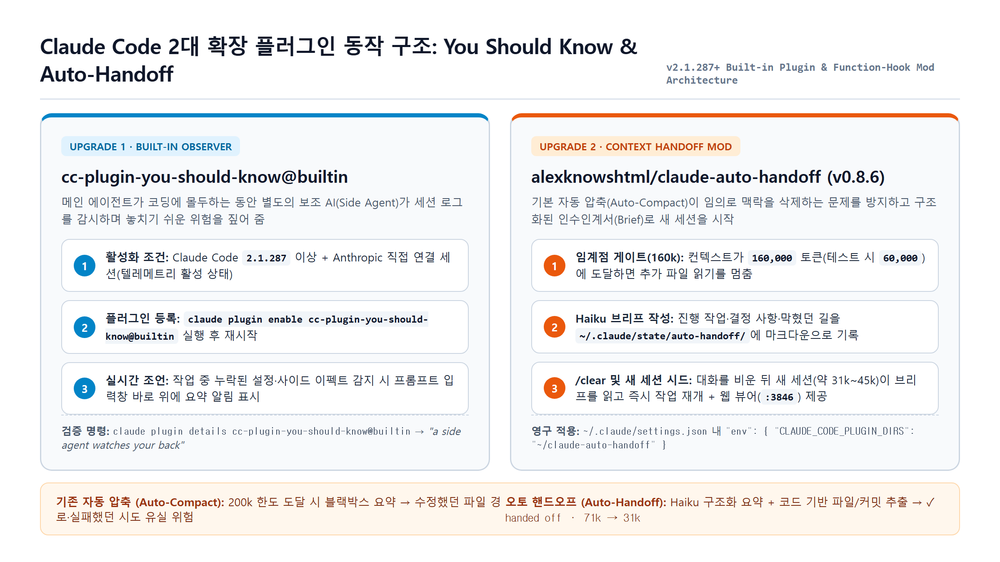
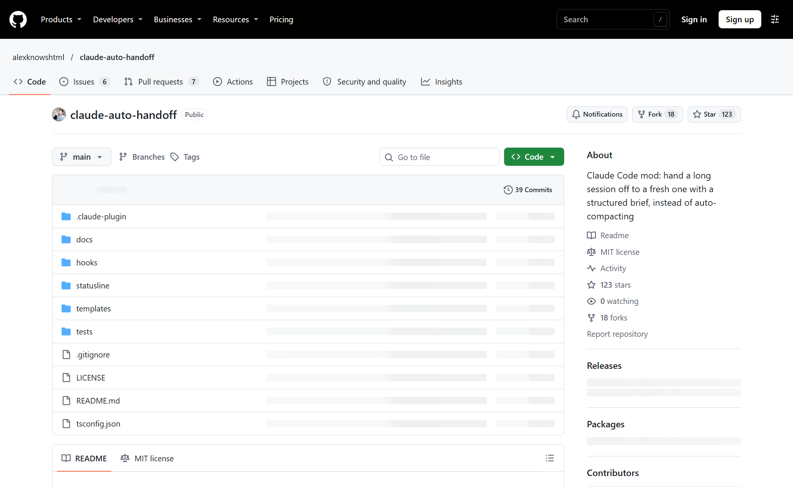
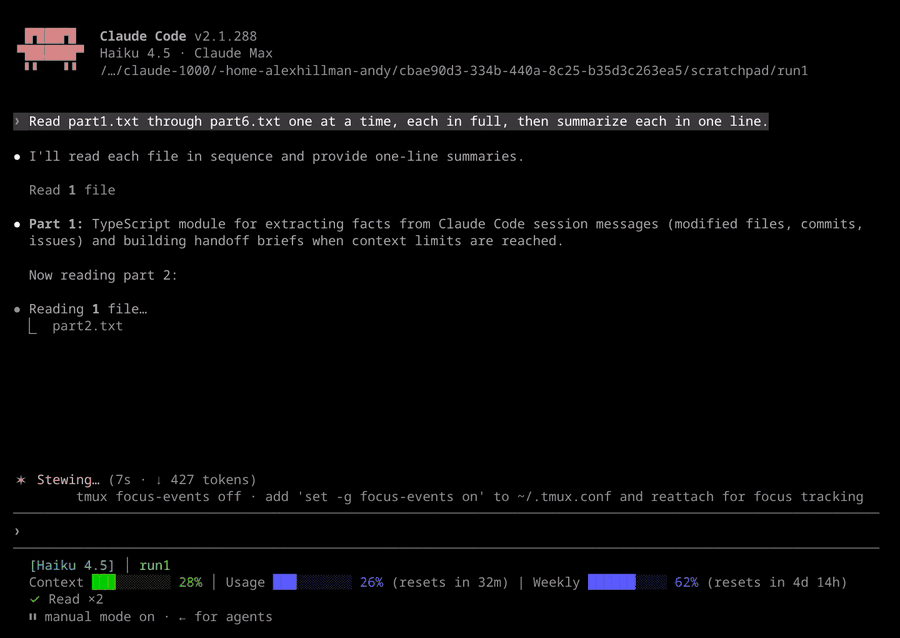

클로드 코드(Claude Code)로 호흡이 긴 작업을 돌리다 보면 가장 아쉬운 순간이 두 번 찾아온다. 첫째는 메인 에이전트가 눈앞의 코드 수정에만 매몰되어 나도 미처 못 본 사이드 이펙트를 그냥 지나칠 때고, 둘째는 대화가 길어져 자동 압축(Auto-Compact)이 돈 직후 방금까지 합의했던 설계 원칙이나 수정 파일 목록을 까맣게 잊어버릴 때다.

사실 이 두 가지 문제는 클로드 코드의 플러그인(Plugin) 및 모드(Mod) 기능 두 개만 붙여도 깔끔하게 해결된다. 하나는 클로드 코드 `2.1.287` 버전부터 본체 안에 내장되어 있지만 기본값으로 꺼져 있는 보조 감시 에이전트 **`You should know`(`cc-plugin-you-should-know@builtin`)**이고, 다른 하나는 긴 세션을 강제 요약하는 대신 Haiku 모델로 구조화된 인수인계서(Brief)를 작성해 새 세션에 바통을 넘겨주는 오픈소스 모드 **`오토 핸드오프`(`alexknowshtml/claude-auto-handoff`)**다.

두 확장 기능을 한 번에 켜고 검증하는 자동화 프롬프트부터 단계별 수동 설치, 내부 동작 원리, 그리고 언제든 원래 상태로 되돌리는 정리 명령까지 차례대로 정리해 보자.

---

## ⚡ 한 번에 끝내는 원샷 프롬프트 (설치부터 검증까지 AI에게 맡기기)

터미널 명령어를 하나씩 치기 귀찮거나 오타가 걱정된다면, 터미널에서 `claude`를 실행한 뒤 첫 메시지로 아래 프롬프트를 그대로 복사해 붙여넣으면 된다. 중간의 `내 목표 = <...>` 부분만 본인의 작업 목적에 맞게 한 줄로 고쳐서 넣자.

```text
역할: 클로드 코드 업그레이드 두 개(You should know, 오토 핸드오프)의 설치와 연결 검증을 맡는 담당
맥락: 오토 핸드오프는 아직 받지 않았을 수 있고, You should know 가 켜져 있는지도 모릅니다.
입력: 내 목표 = <이 업그레이드로 하고 싶은 일, 예: 긴 리팩터링 작업을 맡겨도 앞에서 정한 규칙과 수정 파일을 잊지 않게 하기> (운영체제·셸·프로젝트 종류는 묻지 말고 직접 확인하세요)
작업:
① `claude --version` 과 `git --version` 으로 현재 환경을 직접 확인
② 홈 폴더에 claude-auto-handoff 폴더가 없을 때만 `git clone https://github.com/alexknowshtml/claude-auto-handoff.git ~/claude-auto-handoff` 실행, You should know 는 `claude plugin enable cc-plugin-you-should-know@builtin` 으로 켜기
③ `claude plugin details cc-plugin-you-should-know@builtin`, `claude plugin validate ~/claude-auto-handoff`, `claude --plugin-dir ~/claude-auto-handoff plugin details auto-handoff` 로 검증
④ 두 기능이 각각 무엇을 하는지, 다음부터 `claude --plugin-dir ~/claude-auto-handoff` 로 실행하면 된다는 것을 내 목표에 맞춰 알기 쉽게 안내
제약: 설정을 바꾸는 명령(plugin enable, 설정 파일 수정, sudo, 전역 설치) 전에는 무엇이 바뀌는지 먼저 설명하고 허락 받기, 비밀키·토큰 값 출력 금지, 이미 있는 폴더나 파일 덮어쓰기 금지
출력: 실행한 명령, 확인된 클로드 코드 버전, 바뀐 파일, 남은 오류
검증: `claude plugin enable cc-plugin-you-should-know@builtin` 결과에 Successfully enabled plugin 이 나오고, `claude plugin validate ~/claude-auto-handoff` 마지막 줄에 Validation passed 가 나오고, `claude --plugin-dir ~/claude-auto-handoff plugin details auto-handoff` 첫 줄에 auto-handoff 와 버전 숫자가 나와야 합니다. 하나라도 실패하면 완료로 보고하지 말고 실패한 명령·원인·다음 조치를 알려 주세요.
```

---

## 0. Quick Start & 사전 환경 요약

직접 터미널에서 하나씩 확인하며 세팅하고 싶다면 먼저 두 도구의 성격과 요구 사양을 짚고 넘어가는 게 좋다.


*클로드 코드 내장 옵저버 플러그인(`cc-plugin-you-should-know@builtin`)과 컨텍스트 인수인계 모드(`claude-auto-handoff`)의 역할 분담 구조.*

| 항목 | 업그레이드 1: `You should know` | 업그레이드 2: `오토 핸드오프 (auto-handoff)` |
| :--- | :--- | :--- |
| **정체 및 출처** | Anthropic이 클로드 코드 본체에 기본 내장한 공식 플러그인 | Alex Hillman(`alexknowshtml`)이 공개한 오픈소스 모드 (MIT 라이선스) |
| **핵심 역할** | 보조 AI(Side Agent)가 뒤에서 세션을 지켜보다가 놓치기 쉬운 위험·엣지 케이스를 입력창 위에 짚어 줌 | 컨텍스트 임계점(기본 160k) 도달 시 Haiku가 작업 문서를 작성하고 새 세션으로 바통을 넘김 |
| **필수 버전** | Claude Code `2.1.287` 이상 (Anthropic 직접 연결 및 텔레메트리 활성 필요) | 함수 훅(Function-Hook) 모드를 지원하는 최신 Claude Code + `git` |
| **운영체제 지원** | macOS / Linux / Windows | macOS / Linux 기본 지원 (v0.8.5~0.8.6부터 Windows 로컬 파일 폴백 지원) |
| **추가 비용 여부** | 별도 결제 없음 (단, 보조 AI 호출 토큰이 내 클로드 사용량에 합산됨) | 별도 결제 없음 (단, 인수인계 문서 작성 시 Haiku 모델 토큰이 사용량에 합산됨) |

- **공식 문서**: [code.claude.com](https://code.claude.com/docs/en/overview)
- **클로드 코드 공식 저장소**: [anthropics/claude-code](https://github.com/anthropics/claude-code)
- **오토 핸드오프 공식 저장소**: [alexknowshtml/claude-auto-handoff](https://github.com/alexknowshtml/claude-auto-handoff)

---

## STEP 1. 업그레이드 1 — `You should know` 켜기

첫 번째 업그레이드인 `You should know`는 별도 파일을 내려받을 필요가 없다. 클로드 코드 패키지 안에 이미 들어 있지만 기본적으로 비활성화되어 있는 내장 플러그인을 스위치만 올려서 켜는 과정이다.

### 1) 클로드 코드 버전 확인

터미널에서 현재 설치된 클로드 코드 버전을 먼저 확인한다.

```bash
claude --version
```

`2.1.318 (Claude Code)`처럼 버전 숫자가 출력되면 정상이다. 만약 숫자가 **`2.1.287`보다 낮다면** 아직 `You should know` 플러그인이 포함되지 않은 구버전이므로 `claude update`를 실행해 최신 버전으로 올린다.

> **주의할 점**: 이 기능은 Anthropic에 직접 연결된 세션에서 텔레메트리(사용 기록 전송)가 켜져 있을 때만 활성화된다. 사내 보안 정책 등으로 텔레메트리를 강제로 꺼 둔 환경이라면 켜지지 않을 수 있다.

### 2) 플러그인 활성화 명령 실행

터미널 셸에서 바로 켜거나, 이미 열어 둔 클로드 코드 대화창 안에서 슬래시 명령어로 켤 수 있다.

```bash
# 방법 A: 일반 터미널에서 바로 켜기
claude plugin enable cc-plugin-you-should-know@builtin
```

```text
# 방법 B: 클로드 코드 입력창 안에서 켜기
/plugin enable cc-plugin-you-should-know@builtin
```

성공하면 `✔ Successfully enabled plugin: cc-plugin-you-should-know` 안내가 뜬다. 설정이 반영되도록 이미 열어 둔 클로드 코드 창이 있다면 닫고 새로 실행하자.

- **흔한 실수**: `/plugin enable you-should-know`처럼 이름을 임의로 줄여서 치면 `not found` 에러가 난다. 반드시 앞의 `cc-plugin-`부터 뒤의 `@builtin`까지 전체 식별자를 정확히 입력해야 한다.

### 3) 정상 등록 여부 검증

내 환경에 플러그인이 제대로 잡혔는지 상세 정보를 조회해 본다.

```bash
claude plugin details cc-plugin-you-should-know@builtin
```

첫 줄에 `cc-plugin-you-should-know`가 찍히고, 바로 아래 `Description: You should know: a side agent watches your back`이라는 문구가 보이면 준비 완료다.

---

## STEP 2. 업그레이드 2 — 오토 핸드오프(`claude-auto-handoff`) 받기

두 번째 업그레이드는 긴 대화에서 발생하는 이른바 **컨텍스트 부패(Context Rot)**를 막아주는 도구다.


*`alexknowshtml/claude-auto-handoff` 공식 GitHub 저장소. 기본 자동 압축을 구조화된 인수인계 문서(Brief)와 새 세션 시드로 대체한다.*

### 왜 기본 자동 압축(Auto-Compact) 대신 오토 핸드오프를 쓸까?

클로드 코드의 기본 자동 압축은 컨텍스트 창이 한도 근처까지 차오르면 기존 대화 내역을 제자리에서 요약해 버린다. 문제는 **무엇을 남기고 무엇을 버릴지 사용자가 통제할 수 없다**는 점이다. 특히 압축 과정에서 모델이 건드렸던 파일 경로, 시도했다가 실패한 막다른 길(Dead Ends), 정확한 토큰 수치 등이 뭉개지기 쉽다.

반면 `claude-auto-handoff`는 이원화된 구조로 인수인계서를 만든다.
1. **Haiku 기반 구조화 브리프**: 현재 진행 중인 작업(Work in progress), 확정된 결정(Decisions), 검증할 가정(Assumptions), 실패했던 경로(Dead ends), 사용자의 마지막 요청과 해결 여부, 다음 단계(Next step)를 고정된 마크다운 섹션으로 정리한다.
2. **코드 기반 무결성 추출**: 수정된 파일 목록, 커밋 내역, 이슈, 그리고 실제 토큰 수치(`Handoff Numbers`)는 모델의 기억력에 의존하지 않고 트랜스크립트에서 코드로 직접 추출해 붙인다. (v0.8.3~0.8.4부터는 Haiku가 검증되지 않은 토큰 숫자를 임의로 지어내지 못하도록 검증 로직까지 들어갔다.)

### 1) Git 확인 및 홈 폴더에 클론받기

먼저 `git --version`으로 Git이 설치되어 있는지 확인한 뒤, 홈 디렉터리(`~/claude-auto-handoff`)로 저장소를 클론한다.

```bash
git clone https://github.com/alexknowshtml/claude-auto-handoff.git ~/claude-auto-handoff
```

- 바탕화면이나 다운로드 폴더 등 다른 경로에 받으면 뒤이어 실행할 `--plugin-dir ~/claude-auto-handoff` 경로와 어긋나서 플러그인을 찾지 못한다. 그대로 홈 폴더 아래에 받는 것이 가장 깔끔하다.

### 2) 플러그인 구조 유효성 검사(`validate`)

받은 폴더가 클로드 코드 플러그인 규격에 맞는지 검증 명령을 돌려본다.

```bash
claude plugin validate ~/claude-auto-handoff
```

출력 중간에 `⚠ Found 1 plugin directory warning` 아래로 아이콘 누락 경고(`ICON_MISSING`)와 안내 문구가 길게 나올 수 있는데, 도구 자체에서 `These plugin directory checks do not change the result below`라고 명시하듯 실제 동작에는 아무 영향이 없다. 맨 마지막 줄에 **`✔ Validation passed`**가 찍혔는지만 확인하면 된다.

---

## STEP 3. 오토 핸드오프 붙여서 실행하고 동작 확인하기

이제 실제로 클로드 코드에 오토 핸드오프를 마운트해서 새 세션으로 작업이 넘어가는 과정을 확인해 보자.

### 1) 플러그인 마운트 확인 및 실행

먼저 클로드 코드가 해당 폴더의 모드를 정상 인식하는지 확인한다.

```bash
claude --plugin-dir ~/claude-auto-handoff plugin details auto-handoff
```

첫 줄에 `auto-handoff 0.8.6`처럼 플러그인 이름과 버전이 출력되면 정상이다. 이제 플러그인을 붙여서 클로드 코드를 실행한다.

```bash
claude --plugin-dir ~/claude-auto-handoff
```

그냥 `claude`만 치면 플러그인이 붙지 않으므로, 영구 설정(STEP 4)을 하기 전에는 반드시 `--plugin-dir ~/claude-auto-handoff` 플래그를 함께 줘야 한다.

### 2) 임계값을 60,000 토큰으로 낮춰서 핸드오프 테스트하기

오토 핸드오프의 기본 발동 기준(`threshold`)은 **160,000 토큰**이다(200k 컨텍스트 창에서 브리프 작성과 진행 중인 턴을 처리할 여유 공간을 남긴 수치다). 당장 동작하는 모습을 눈으로 확인하고 싶다면, 일회성 환경 변수 `AUTO_HANDOFF_TOKENS=60000`을 앞에 붙여 실행해 보자.

```bash
AUTO_HANDOFF_TOKENS=60000 claude --plugin-dir ~/claude-auto-handoff
```


*오토 핸드오프 공식 데모 화면(임계값 80k 설정 기준). 임계점에 도달하면 추가 파일 읽기를 멈추고 브리프 작성 → `/clear` → 새 세션 시드까지 약 7초 만에 완료된 뒤 `71k → 31k`로 줄어든 새 세션이 작업을 이어간다.*

긴 파일 여러 개를 읽히는 작업을 시켜 기준 토큰에 도달하면 프롬프트 입력창 바로 위 패널에서 세 단계가 순서대로 체크된다.

1. **정리 문서 쓰기 (`writing the brief`)**: `~/.claude/state/auto-handoff/<세션ID>.md` 경로에 마크다운 브리프를 생성한다.
2. **대화 비우기 (`clearing`)**: `/clear`를 실행해 무거워진 기존 세션을 비운다.
3. **새 세션 시작 (`starting the fresh session`)**: 새 세션에 브리프 경로를 한 줄로 넘겨주며, 완료되면 **`✓ handed off · 71k → 31k`** 같은 요약 줄과 **`open brief`** 링크가 표시된다.

### 3) 웹 뷰어(`open brief`)와 정상 안내 문구 이해하기

패널에 뜬 `open brief` 링크를 클릭하면 방금 작성된 인수인계 문서가 깔끔한 웹페이지(`~/.claude/state/auto-handoff/pages/`)로 열린다.
- **Tailscale 사용 시**: 기본적으로 내 컴퓨터의 Tailscale IP `3846` 포트(`http://100.x.y.z:3846/...`)에 띄워지므로, 같은 Tailscale 비공개망에 묶인 스마트폰이나 태블릿에서도 진행 상황을 바로 열어볼 수 있다.
- **Tailscale 미사용 시**: 자동으로 로컬호스트(`127.0.0.1`)에 띄워져 내 컴퓨터 브라우저에서만 열린다. (Windows처럼 POSIX `sh`가 없는 환경에서는 v0.8.6부터 로컬 파일을 직접 여는 방식으로 안전하게 폴백된다.)

테스트 중 아래 세 가지 상황이 나타나더라도 오류가 아니라 정상적인 안전장치(Loop Guard) 동작이다.
- **앞 대화가 화면에서 사라짐**: 핸드오프 과정에서 `/clear`로 화면을 비웠기 때문이다. 모든 핵심 맥락은 정리 문서에 보존되어 있다.
- **`threshold 60k (AUTO_HANDOFF_TOKENS) leaves 15k ...` 안내 배너**: 새로 시작된 세션은 기본 시스템 프롬프트와 브리프를 포함해 약 `45k` 토큰 근처에서 출발한다. 무한 루프를 막기 위해 새 세션은 **출발 크기에서 최소 `40k` 토큰을 더 써야** 다음 핸드오프가 발동하도록 설계되어 있는데, 테스트용으로 기준을 `60k`로 낮춰 두었기 때문에 실제 다음 핸드오프 지점을 친절하게 알려주는 것이다(`Dismiss`를 누르면 닫힌다).
- **2회 연속 핸드오프 후 일시 정지**: 사용자가 아무 입력도 하지 않은 채 자율 실행만으로 핸드오프가 일어날 때는 기본값으로 **최대 2번(`maxConsecutiveHandoffs: 2`)까지만 연속 허용**하고 멈춘다. 메시지를 한 번 입력하면 카운터가 초기화되며 다시 진행된다.

> **만약 핸드오프가 아예 작동하지 않는다면?** 터미널 환경 변수나 `~/.claude/settings.json` 안에 `DISABLE_AUTO_COMPACT` 설정이 켜져 있는지 확인하자. 이 변수가 설정되어 있으면 오토 핸드오프도 외부 래퍼 파이프를 깨뜨리지 않기 위해 함께 비활성화된다.

### 4) 보안 주의사항 및 로컬 기록 삭제법

민감한 사내 코드나 개인정보를 다룬 세션이라면 인수인계 기록이 아래 세 경로에 텍스트로 남는다는 점을 기억해야 한다.
- `~/.claude/state/auto-handoff/` (세션별 마크다운 브리프)
- `~/.claude/state/auto-handoff/pages/` (웹 뷰어용 HTML 페이지)
- `~/.claude/state/auto-handoff/auto-handoff.log` (동작 로그)

웹 뷰어 서버 자체를 끄고 싶다면 클로드 코드 입력창에서 `/config`를 열고 `auto-handoff` 항목의 `viewer` 값을 비워 두면 된다. 또한 작업이 끝난 뒤 저장된 브리프와 로그를 한 번에 지우려면 클로드 코드를 모두 닫고 아래 명령을 실행한다.

```bash
# 주의: ~/.claude 전체가 아니라 반드시 끝의 /state/auto-handoff 까지 정확히 입력할 것!
rm -rf ~/.claude/state/auto-handoff
```

---

## STEP 4. 매번 자동으로 켜지게 만들고 언제든 되돌리는 법

매번 `claude --plugin-dir ~/claude-auto-handoff`를 길게 타이핑하는 대신, 그냥 `claude`만 쳐도 항상 오토 핸드오프가 자동으로 로드되도록 `~/.claude/settings.json`에 등록해 두자.

### 1) 기존 설정 파일 백업 및 영구 등록

JSON 파일을 직접 열었다가 쉼표나 중괄호를 잘못 건드려 설정이 깨지는 일을 막기 위해, 먼저 백업본(`.bak`)을 만든 뒤 클로드 코드에게 수정을 맡기는 편이 가장 안전하다.

```bash
cp ~/.claude/settings.json ~/.claude/settings.json.bak
```

그다음 클로드 코드 창에 아래 요청을 붙여넣는다.

```text
~/.claude/settings.json 의 env 칸에 CLAUDE_CODE_PLUGIN_DIRS 를 추가해 주세요. 값은 홈 폴더에 있는 claude-auto-handoff 폴더의 전체 경로입니다. 다른 설정은 그대로 두고, 바꾸기 전과 후의 내용을 보여 주세요.
```

수정이 끝나면 `~/.claude/settings.json` 안에 다음과 같은 블록이 추가된다(기존 설정은 유지한 채 `env` 항목만 병합되어야 한다).

```json
{
  "env": {
    "CLAUDE_CODE_PLUGIN_DIRS": "~/claude-auto-handoff"
  }
}
```

새 터미널 창을 열어 `--plugin-dir` 옵션 없이 아래 확인 명령을 쳤을 때 `auto-handoff 0.8.6`이 바로 뜨면 영구 등록이 끝난 것이다.

```bash
claude plugin details auto-handoff
```

참고로 첫 실행 시 `~/.claude/auto-handoff/` 폴더에 브리프 양식 파일 두 개(`brief.md`, `instructions.md`)가 복사된다. 인수인계서에 들어갈 `## ` 섹션 구성을 내 입맛대로 바꾸고 싶다면 저장소 원본 대신 이 복사본을 수정하면 나중에 `git pull`로 업데이트해도 내 양식이 덮어써지지 않는다.

### 2) 두 업그레이드를 끄거나 완전히 삭제하는 명령

상황에 따라 기능을 잠시 끄거나 완전히 제거하고 싶을 때는 아래 명령을 쓰면 된다.

```bash
# 1. You should know 플러그인 끄기
claude plugin disable cc-plugin-you-should-know@builtin

# 2. 이번 세션에서만 오토 핸드오프 끄고 순정 상태로 실행하기
AUTO_HANDOFF_DISABLE=1 claude

# 3. 오토 핸드오프 완전 삭제 (~/.claude/settings.json 에서 CLAUDE_CODE_PLUGIN_DIRS 제거 후 실행)
rm -rf ~/claude-auto-handoff ~/.claude/state/auto-handoff ~/.claude/auto-handoff
```

---

## 마무리 요약

클로드 코드를 쓰면서 가장 아까운 토큰 낭비는 "방금 전까지 다 설명해 놨는데 자동 압축 한 번 돌았다고 처음부터 다시 설명하느라 쓰는 토큰"이다.
- 내장 옵저버인 **`cc-plugin-you-should-know@builtin`**으로 작업 중 사각지대를 실시간으로 점검받고,
- **`claude-auto-handoff`**로 160k 임계점마다 깔끔하게 정제된 브리프를 새 세션에 넘겨주면, 긴 세션에서도 첫 턴처럼 빠릿빠릿한 응답 품질을 유지할 수 있다. 아직 안 켜봤다면 오늘 터미널에서 바로 두 줄만 적용해 보길 권한다.
