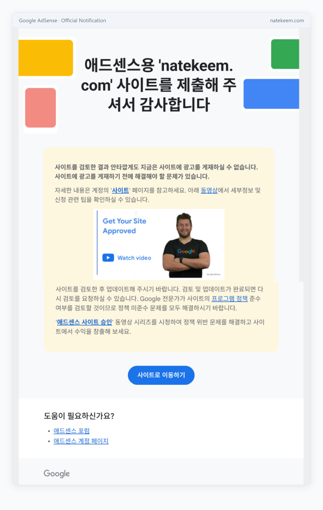
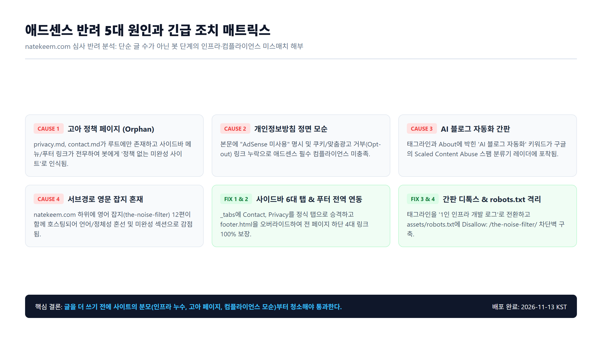

불과 며칠 전, 나는 커밋로그 32번째 글에서 영문 스마트홈 블로그와 오픽 학습 사이트의 애드센스 동시 탈락을 분석하며 의기양양하게 글을 맺었었다.

> *"natekeem.com은 애드센스 테이블에 '준비 중'으로 떠 있고 ads.txt도 승인되었으니, 글 37편의 밀도라면 무난히 통과하겠지."*

오만한 착각이었다. 오늘 오후 메일함을 열자마자 구글 애드센스 팀으로부터 너무나 익숙하고도 차가운 한 줄의 메일이 날아와 있었다.

> **"사이트를 검토한 결과 안타깝게도 지금은 사이트에 광고를 게재하실 수 없습니다. 사유: 가치가 별로 없는 콘텐츠(Low-value content)"**

영문 사이트도 아니고, 내가 매일 손으로 코드를 치고 빌드 로그를 남기던 이 개발 블로그 본진마저 "가치 없는 사이트" 딱지를 맞은 것이다. 순간 머리가 멍해졌지만, 멍하니 있을 시간이 없었다. 즉시 저장소의 설정 파일, 빌드된 정적 HTML, 사이트맵, 그리고 크롤러의 동선을 뜯어보기 시작했다.

그리고 소스코드를 한 줄씩 뒤집어까 보던 나는 등골이 서늘해졌다. 구글 심사 봇이 보기에 이 사이트는 **'가치'를 논하기 이전에, 봇 단계에서 광탈할 수밖에 없는 치명적인 인프라 누수 5가지**를 온몸에 두르고 있었기 때문이다.


*오늘 오후 구글 애드센스로부터 실제로 수신한 natekeem.com 심사 반려 안내 메일.*

---

## 1. 똑같은 반려 통보 뒤에 숨어 있던 5대 진짜 원인

구글의 도움말 링크를 백날 읽어봐야 원인을 알 수 없다. 실제로 코드를 뒤져 찾아낸 5가지 기술적·구조적 결함은 다음과 같았다.



### ① 고아 정책 페이지 (Orphan Page Trap)
가장 어처구니없는 실수였다. 저장소 루트에 `privacy.md`, `contact.md`, `disclosure.md` 파일은 분명히 존재했다. 

그런데 지킬 Chirpy 테마는 `_tabs/` 폴더 안에 들어있는 파일만 사이드바 메뉴 탭으로 렌더링한다. 게다가 푸터 커스텀도 하지 않아 기본 푸터만 떠 있었다. 즉, **방문자나 구글 심사 봇이 사이트에 접속했을 때 `Privacy Policy`나 `Contact`로 갈 수 있는 링크가 사이트 전체 어디에도 단 하나도 없었다.** 크롤러 입장에서는 개인정보처리방침도 없고 문의 창구도 없는 '미완성 익명 사이트'로 보였던 것이다.

### ② 개인정보방침(Privacy Policy)의 정면 모순
뒤통수를 세게 맞은 기분이었다. 루트에 방치되어 있던 `privacy.md`의 본문을 열어보니 기가 막힌 문장이 박혀 있었다.

```markdown
## 현재 사용하지 않는 것
- AdSense
- Google Analytics
...
```

애드센스를 심사받겠다고 신청해 놓고, 정작 개인정보처리방침에는 **"이 블로그는 AdSense를 쓰지 않습니다"**라고 대문짝만하게 적어두었던 것이다. 게다가 애드센스 필수 승인 요건인 **쿠키 사용 고지, 제3자 공급업체 맞춤 광고 안내, 구글 광고 설정 거부(Opt-out) 링크**가 100% 빠져 있었다. 심사관이나 검수 봇이 이 페이지를 열어봤다면 '승인 거부' 버튼을 누르는 데 1초도 걸리지 않았을 것이다.

### ③ 'AI 블로그 자동화'라는 간판의 역설 (Scaled Abuse 필터)
구글은 최근 '대량 생성된 AI 자동화 스팸(Scaled Content Abuse)'을 기계적으로 걸러내고 있다. 그런데 내 블로그의 대문 간판은 어땠을까?

* `_config.yml` 태그라인: `"AI 블로그 자동화 프로젝트를 차근차근 커밋하는 기록"`
* 사이트 메타 설명: `"AI-assisted blogging, 자동화, SEO..."`
* About 페이지: `"AI로 수익형 블로그를 전자동으로 찍어내는 마법 같은 시스템을 꿈꿨다..."`

본문 글들은 실제 개발자의 1인칭 디버깅과 수동 검수(Human Gate) 기록이었지만, **사이트의 문패에 'AI 블로그 자동화'라는 단어가 박혀 있으니** 구글의 스팸 머신러닝 분류기가 본문을 읽어보기도 전에 'AI 스팸 양산 공장'으로 플래그를 찍었을 가능성이 매우 컸다.

### ④ 도메인 레벨 심사와 영문 잡지(`the-noise-filter`) 서브경로 혼재
애드센스는 서브디렉토리가 아니라 **`natekeem.com` 루트 도메인 전체를 하나의 묶음으로 심사**한다.

그런데 내 GitHub Pages 설정상 `natekeem.com/the-noise-filter/`라는 서브경로에 별도로 배포되던 영문 시사·테크 매거진 12편이 그대로 살아 있었다. 한국어 개발 블로그 밑에 완전히 다른 언어(영어)와 다른 템플릿(AstroPaper)의 미완성 잡지가 엉켜 있었으니, 봇 시선에서는 "언어가 뒤섞이고 네비게이션이 분열된 사이트"로 감점당할 수밖에 없었다.

### ⑤ 오가닉 트래픽(Organic Traffic)의 절대적 부족
결국 애드센스 봇이 말하는 '가치 있는 콘텐츠'의 절반은 **"실제 구글 검색을 통해 사람이 이 글을 찾아 들어오는가(Organic Clicks)?"**다. 

스마트 서버버나이트 때도 겪었지만, 글이 30편 넘게 쌓였어도 검색 유입이 일 0~3회 수준인 초기 블로그는 구글 알고리즘 관점에서 "아직 대중적 수요가 입증되지 않은 사이트"로 기계적 판정을 받게 된다.

---

## 2. 즉시 진행한 4대 긴급 수술 내역

원인이 명확해졌으니 즉시 코드 수술에 착수했다.

### 1) 사이드바 6대 탭 확립 및 푸터 전역 링크 주입
* 루트에 굴러다니던 `contact.md`와 `privacy.md`를 `_tabs/` 폴더로 정식 승격했다.
  * `_tabs/contact.md` (order: 5, icon: fas fa-envelope)
  * `_tabs/privacy.md` (order: 6, icon: fas fa-shield-alt)
* Chirpy 테마의 `_includes/footer.html`을 오버라이드하여, 사이트 내 37개 모든 글과 카테고리 하단에 `About · Contact · Privacy Policy · Disclosure` 링크가 100% 노출되도록 주입했다.

### 2) Privacy Policy 전면 개정 & 공식 연락처 연동
* "AdSense 미사용" 문구를 영구 삭제하고, 구글 애드센스 공식 필수 규정(쿠키 고지, 맞춤 광고 안내, aboutads.info 및 Google 광고 설정 거부 링크)을 삽입했다.
* `_config.yml`의 `social: email:`에 공식 소통 이메일(`86seongmin.kim@gmail.com`)을 등록하여 사이드바 하단 메일 아이콘(`envelope`)을 활성화했다.

### 3) 브랜딩 & 메타데이터 디톡스 (Anti-AI Spam)
* 스팸 의심을 부르던 간판을 정통 엔지니어링 기술 블로그 톤으로 정돈했다.
  * 태그라인: `"AI 에이전트와 웹 기술, 1인 인프라 구축을 차근차근 커밋하는 기록"`
  * 설명: `"AI 에이전트 활용, 웹 기술, 오픈소스 분석, 인프라 트러블슈팅을 기록하는 나태킴의 개발 로그입니다."`
* `_tabs/about.md`에서도 "수익형 블로그 자동화" 같은 자극적인 수식을 걷어내고, 1인 개발자의 인프라 구축과 수동 검수 원칙(Human Gate)을 강조했다.

### 4) `robots.txt`에 서브경로 격리벽 구축
* `assets/robots.txt`를 생성하여 다음 규칙을 심었다.

```text
User-agent: *
Disallow: /the-noise-filter/
Disallow: /norobots/

Sitemap: https://natekeem.com/sitemap.xml
```

이제 애드센스 심사 봇과 구글봇은 `natekeem.com`을 스캔할 때 서브경로의 영문 잡지로 새지 않고, **오직 한국어 IT 개발 블로그만 깨끗하게 심사**하게 된다.

---

## 3. 로컬 빌드 및 내부 링크 194개 전수 검증

수정을 마친 뒤 로컬에서 Jekyll 빌드를 돌리고, 스크립트를 짜서 사이트 내 모든 내부 링크를 검증했다.

```text
Configuration file: dev_blog/_config.yml
            Source: dev_blog
       Destination: dev_blog/_site
      Generating... done in 8.716 seconds.

[내부 링크 전수 검증 결과]
Internal links checked: 194
Errors: 0 (깨진 링크 없음)
```

사이드바 6대 탭, 푸터 4대 정책 링크, 신규 `robots.txt`가 단 1개의 오류도 없이 완벽하게 물려 돌아가는 것을 확인한 뒤 깃허브에 커밋(`40a8acb`) 및 푸시를 완료했다.

---

## 4. 이번에도 '재검토 요청' 버튼을 바로 누르지 않는 이유

배포가 끝났다고 해서 곧바로 애드센스 대시보드로 달려가 [재검토 요청]을 누르면 안 된다.

1. **배포는 내 컴퓨터의 일이고, 인덱싱은 구글의 일이다**: 내가 `robots.txt`를 올리고 `_tabs`를 바꿨다고 구글봇이 1초 만에 알아채지 못한다. 구글 크롤러가 사이트를 다시 긁어가기까지는 물리적으로 며칠의 시간이 걸린다.
2. **서치콘솔에서 크롤링을 먼저 유도해야 한다**: 서치콘솔에 들어가 `sitemap.xml`을 다시 제출하고, 메인 홈페이지와 `/privacy/` URL에 대해 [색인 생성 요청]을 넣어 구글봇을 먼저 호출했다.
3. **숫자가 바뀐 뒤에 움직인다**: 구글 크롤러가 새로운 푸터와 정책 페이지를 수집해 간 것을 서치콘솔에서 확인한 뒤(약 3~5일 뒤), 그때 비로소 애드센스 재검토 버튼을 누를 생각이다.

남의 블로그 컨설팅하듯 글을 쓰다가 내 발등을 찍힌 하루였지만, 덕분에 본진 블로그의 썩어 있던 정책 네비게이션과 컴플라이언스 구멍을 완벽하게 봉합했다. 며칠 뒤 구글봇이 다녀간 뒤 다시 심사를 넣어보고 결과를 기록하겠다.
