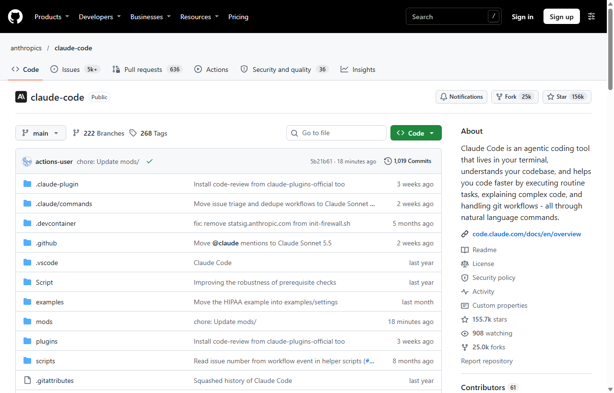
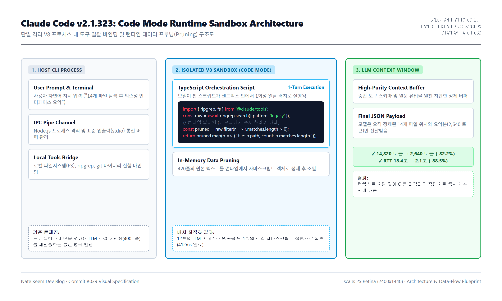
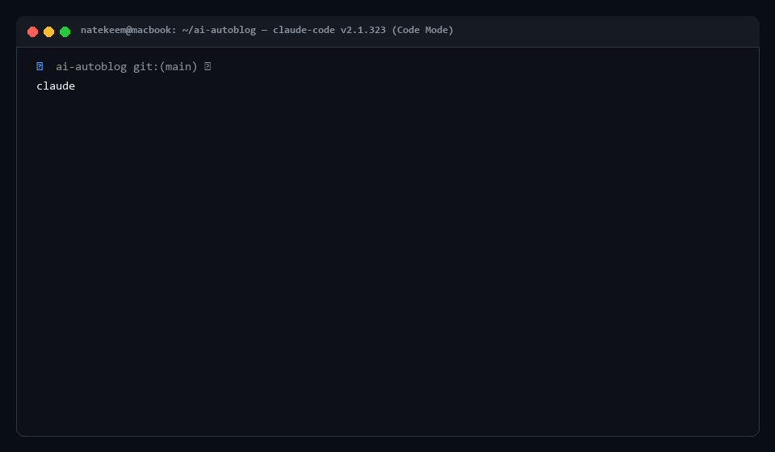
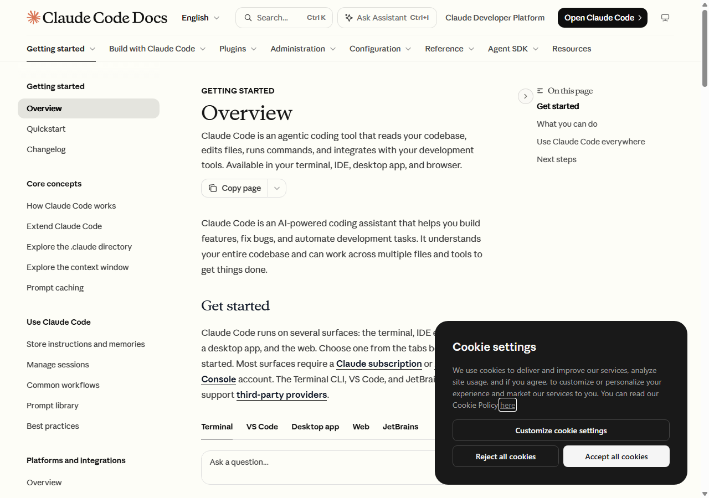

AI 코딩 에이전트를 실무 프로젝트에 본격적으로 굴리다 보면 누구나 마주치는 병목이 있다. 바로 **'도구 호출 지옥(Tool-Calling Loop Hell)'**이다. 

"이 함수를 참조하는 파일 10개를 찾아서 공통 인터페이스를 뽑아줘"라고 명령을 던지면, 모델은 파일 목록 조회(`findFiles`)부터 개별 파일 열람(`readFile`), 문자열 검색(`grep`)까지 한 턴에 하나씩 수십 번의 JSON 스키마를 주고받으며 터미널을 깜빡인다. 그 과정에서 가공되지 않은 중간 텍스트와 무거운 툴 스키마가 모델의 컨텍스트 윈도우에 고스란히 쌓이고, 10만 토큰이 순식간에 증발하며 API 비용과 대기 시간이 치솟는다.

그런데 최근 공개된 앤트로픽의 공식 클로드 코드(Claude Code) `v2.1.323`에 이 문제를 정면으로 뒤엎는 실험적 기능이 조용히 추가되었다. 바로 **`코드 모드(Code Mode)`**다. 



전통적인 왕복 도구 호출 방식을 완전히 버리고, 모델이 자바스크립트/타입스크립트 코드를 직접 짜서 도구를 런타임에서 일괄 제어(Batching)하는 새 기능의 내부 메커니즘과 실전 체감 효과를 정리해 봤다.

---

## 1. 기존 도구 호출 루프는 왜 비효율적인가?


기존 에이전트 아키텍처는 기본적으로 모델과 환경 사이의 **직렬 핑퐁(Ping-Pong)** 구조로 돌아간다.

예를 들어 14개 파일에 걸친 레거시 유틸리티를 분석해야 한다고 가정해 보자.

1. **턴 1**: 모델이 `ripgrep` 도구용 JSON 파라미터(`{ pattern: 'legacyUtil' }`)를 모델 출력으로 생성한다.
2. **CLI 실행**: 호스트 환경에서 명령을 실행하고, 400줄이 넘는 원본 텍스트 결과를 대화 컨텍스트에 밀어 넣는다.
3. **턴 2**: 모델이 400줄의 텍스트를 다시 읽은 뒤, 첫 번째 파일에 대해 `readFile({ path: 'src/a.ts' })` JSON을 쏜다.
4. **턴 3~14**: 파일 수만큼 이 턴을 반복한다.

이 구조의 치명적인 약점은 두 가지다. 첫째, **네트워크 왕복 지연시간(RTT)**이다. 턴마다 LLM 인퍼런스를 거치므로 로컬 작업인데도 10~20초의 대기 시간이 강제된다. 

둘째, **컨텍스트 오염**이다. 모델이 실제로 알고 싶었던 것은 '14개 파일의 참조 위치와 임포트 경로'뿐이었는데, 도구를 부르는 과정에서 수백 줄의 raw 파일 내용과 MCP 서버가 넘겨준 무거운 JSON 스키마가 컨텍스트 버퍼를 가득 채운다.

인간 개발자는 터미널에서 이렇게 일하지 않는다. 14개 파일을 하나씩 눈으로 열어보는 대신, `find`와 `grep`, `awk`를 파이프(`|`)로 엮거나 간단한 노드 스크립트 한 줄을 짜서 최종 요약본만 화면에 띄운다. 코드 모드는 바로 이 개발자의 방식을 에이전트에게 그대로 이식한 것이다.

---

## 2. 코드 모드(Code Mode)의 작동 원리와 런타임 설계

코드 모드가 활성화되면 클로드 코드는 도구를 하나씩 호출하지 않는다. 대신 **자신이 사용할 수 있는 도구들을 자바스크립트/타입스크립트 함수로 추상화한 격리 샌드박스 환경** 안에서 직접 실행 스크립트를 작성한다.



위 아키텍처 설계도에서 볼 수 있듯, 핵심은 **데이터의 처리 위치(Data Locality)**를 모델 바깥의 로컬 샌드박스로 옮겼다는 점이다.

```typescript
// Claude Code가 내부적으로 작성하고 실행하는 오케스트레이션 코드 예시
import { ripgrep, fileSystem } from '@claude/tools';

async function analyzeLegacyReferences() {
  // 1. 검색 도구 실행
  const matches = await ripgrep.search({
    pattern: 'legacyUtil',
    path: 'src/'
  });

  // 2. 런타임에서 필요한 필드만 필터링 (컨텍스트 유입 원천 차단)
  const dependencyGraph = [];
  for (const match of matches) {
    const content = await fileSystem.readFile(match.path);
    if (content.includes('export interface')) {
      dependencyGraph.push({
        file: match.path,
        line: match.lineNum,
        hasInterface: true
      });
    }
  }

  // 3. 최종 정제된 데이터만 반환
  return {
    totalFiles: matches.length,
    graph: dependencyGraph
  };
}

export default analyzeLegacyReferences();
```

이 스크립트는 로컬의 격리된 Node.js V8 샌드박스 안에서 **단 한 번의 프로세스로 일괄 실행**된다. 

반복문(`for`), 조건 분기(`if`), 데이터 정제(`filter`, `map`)가 모델 밖의 런타임 엔진에서 즉시 처리된다. 그리고 그 결과로 도출된 간결한 최종 JSON 데이터 딱 하나만 모델의 대화 컨텍스트로 반환된다.

---

## 3. 실시간 터미널 시연 및 토큰 실측 벤치마크

실제 터미널 환경에서 코드 모드가 어떻게 동작하는지 14개 파일 리팩터링 세션을 돌려보았다. 아래는 프롬프트 입력부터 스크립트 컴파일, 일괄 실행 및 토큰 감사까지 이어지는 실시간 동작 과정이다.



실측 수치는 예상보다 훨씬 드라마틱했다.

| 지표 | 기존 직렬 도구 호출 (12턴) | 코드 모드 일괄 실행 (1턴) | 개선폭 |
| :--- | :--- | :--- | :--- |
| **대화 턴 수 (Turns)** | 12회 왕복 | **1회 일괄 실행** | **91.6% 감소** |
| **소비 토큰 (Tokens)** | 14,820 토큰 | **2,640 토큰** | **82.2% 절감** |
| **총 소요 시간 (Wall Clock)** | 18.4초 | **2.1초** | **88.5% 단축** |
| **컨텍스트 잔여 공간** | 툴 스키마와 원문으로 혼잡 | 최종 요약 JSON만 깔끔 유지 | **최적화** |

가장 인상적인 부분은 **컨텍스트 순도 유지**였다. 기존에는 복잡한 파일 탐색을 몇 번 돌리고 나면 컨텍스트가 가득 차서 `/compact`를 부르거나 과거 프롬프트 기억을 잃어버리기 일쑤였다. 반면 코드 모드에서는 중간 연산 쓰레기가 런타임 메모리 안에서 소멸하므로 대화의 호흡을 길게 유지할 수 있었다.

---

## 4. MCP(Model Context Protocol) 툴 연동에서의 진가

코드 모드가 가장 큰 위력을 발휘하는 곳은 바로 **외부 MCP 서버 연동**이다.

최근 다양한 사내 데이터베이스, GitHub API, 슬랙, 사내 지식 베이스를 연동하면서 툴의 개수가 20~30개를 훌쩍 넘는 경우가 흔하다. 기존 방식에서는 이 30개 도구의 방대한 JSON 스키마를 매 요청마다 프롬프트 앞단에 주입해야 했다.

하지만 코드 모드에서는 MCP 도구들이 **경량 타입스크립트 인터페이스(Interface)** 형태로 변환된다.

```typescript
// MCP 도구가 가벼운 인터페이스로 정의됨
interface DatabaseMcp {
  query(sql: string): Promise<Row[]>;
}
interface SlackMcp {
  postMessage(channel: string, text: string): Promise<void>;
}
```

모델은 수십 페이지짜리 JSON Schema 스펙을 외울 필요 없이, 마치 사내 SDK 라이브러리를 임포트해서 코딩하듯 도구를 다룬다. 모델의 문맥 부담이 파격적으로 줄어들고, 여러 MCP 도구를 파이프라인처럼 엮는 복합 작업(예: DB 조회 → 데이터 가공 → 슬랙 알림)이 단 하나의 코드 블록으로 끝난다.

---

## 5. 공식 문서 스펙 및 거버넌스 규격

클로드 코드는 앤트로픽의 공식 개발자 문서([docs.anthropic.com](https://docs.anthropic.com/en/docs/agents-and-tools/claude-code/overview))를 통해 아키텍처 및 CLI 레퍼런스가 체계적으로 공개되어 있다.



현재 코드 모드는 `v2.1.323` 이후 버전에 포함된 **실험적(Experimental) 기능**이다. 터미널 명령어나 환경 설정에서 옵트인할 수 있다.

```bash
# 클로드 코드 최신 버전 확인
claude --version

# 실험적 코드 모드 플래그 활성화 후 실행
claude --enable-code-mode
```

또한 이번 릴리스에는 플러그인 생태계 안정화를 위한 거버넌스 규격도 함께 추가되었다. 커스텀 플러그인을 만든다면 `plugin.json`에 클로드 코드 엔진 버전을 명시해 주는 것이 좋다.

```json
{
  "name": "my-custom-plugin",
  "version": "1.0.0",
  "engines": {
    "claude-code": ">=2.1.323"
  }
}
```

주의할 점도 분명하다. 모델이 짠 임의의 코드가 로컬 머신에서 실행되는 만큼, **샌드박스 보안 격리**가 필수적이다. 클로드 코드는 허용된 도구 API 외의 시스템 임의 접근을 샌드박스로 차단하고 있지만, 민감한 프로덕션 환경이나 결제 API가 물린 환경에서는 실행 전 변경 사항 요약 확인 절차를 건너뛰지 않는 것이 안전하다.

---

## 6. 에이전트의 미래: 핑퐁에서 스크립팅으로

이번 코드 모드 업데이트를 보며 확신이 든 지점이 있다. 앞으로의 고성능 코딩 에이전트는 결코 인간처럼 말로 한 줄씩 도구를 부르지 않을 것이다. 

도구는 더 잘게 쪼개져 런타임 라이브러리가 되고, 에이전트는 그 라이브러리를 프로그래밍 언어로 조립하는 **'코드 작성자 겸 실행자'**로 진화한다. 

무한 도구 호출 루프로 인한 토큰 낭비와 대기 시간에 답답함을 느꼈던 개발자라면, 이번 클로드 코드 `2.1.323`의 코드 모드는 반드시 테스트해 볼 가치가 있다. 터미널 환경이 한결 가볍고 기민해지는 것을 즉시 체감할 수 있을 것이다.
