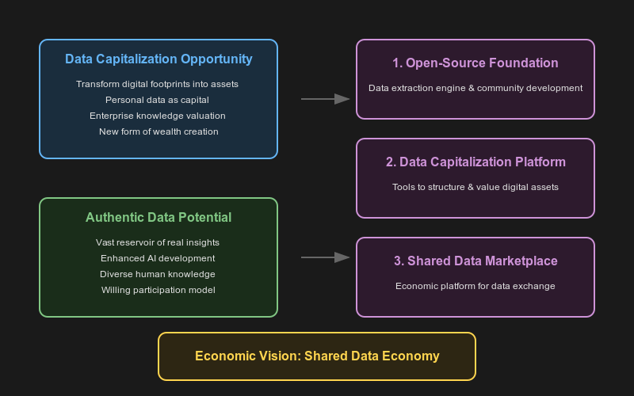
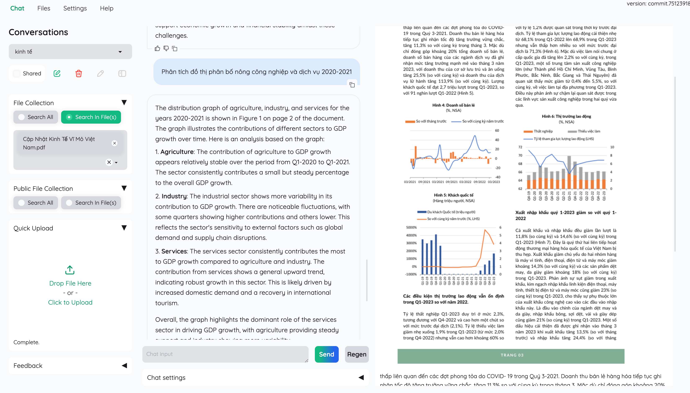
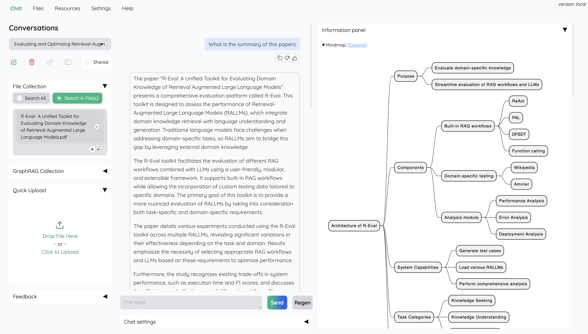
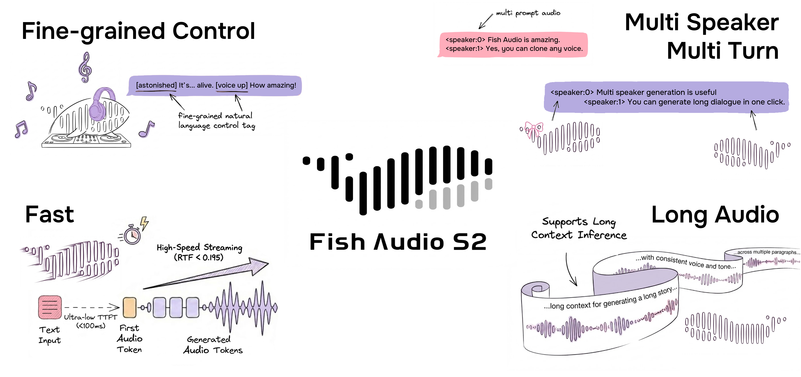
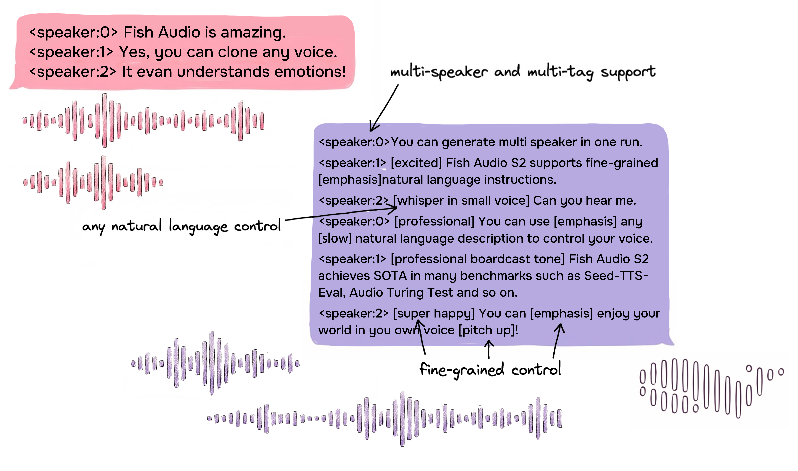
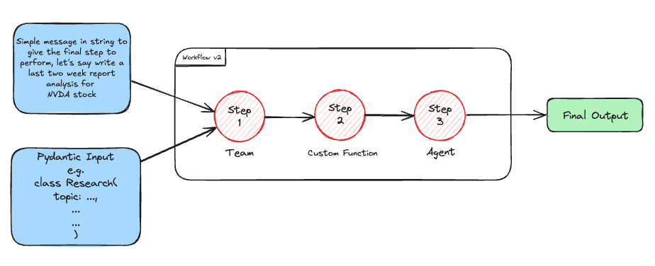
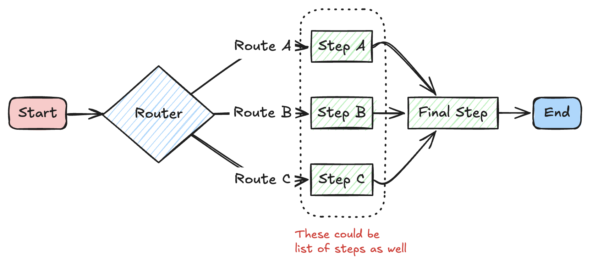
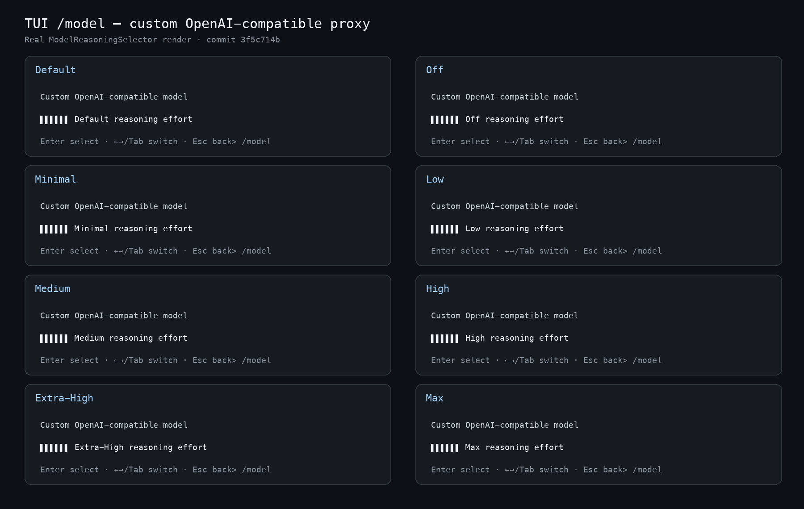

대형 언어 모델의 추론 단가는 빠르게 떨어졌지만, 실제 서비스 인프라에 LLM을 물려본 개발자들의 한숨은 여전하다. 복잡한 자바스크립트로 뒤덮인 웹페이지에서 노이즈 없는 마크다운을 긁어오는 작업, 표와 수식이 뒤섞인 사내 PDF를 청킹해 정확한 출처 각주를 다는 작업, 그리고 수백 번의 대화가 오가도 맥락을 잊지 않는 장기 메모리 아키텍처를 구현하는 일은 API 호출 한 줄로 해결되지 않는다.

이번 `#06`은 **2026년 11월 15일 KST 기준 GitHub API 릴리스 스냅샷**을 바탕으로, 기존 `#01~#05` 시리즈에서 한 번도 다루지 않았던 실무 데이터 파이프라인 및 에이전트 런타임 저장소 5개를 엄선했다. 화려한 랜딩 페이지만 있고 실제 파이프라인에 얹으면 메모리 누수로 터지는 데모성 라이브러리는 제외하고, 패키지 매니저(`pip`, `uv`, `npm`)로 즉시 빌드해 검증할 수 있는 도구들이다.

---

## 2026-11-15 실용성 기준 TOP 5

| 순위 | 저장소 | 스냅샷 (Stars / Forks) | 라이선스 | 최신 릴리스 | 핵심 해결 과제 |
| ---: | --- | ---: | --- | --- | --- |
| **1위** | [unclecode/crawl4ai](https://github.com/unclecode/crawl4ai){: target="_blank" rel="noopener noreferrer"} | 87,382 / 9,116 | Apache-2.0 | `v0.9.5` | 동적 JS 웹사이트를 초고속 비동기 세션으로 크롤링해 LLM 최적화 마크다운과 구조화 JSON을 추출한다 |
| **2위** | [Cinnamon/kotaemon](https://github.com/Cinnamon/kotaemon){: target="_blank" rel="noopener noreferrer"} | 25,909 / 2,168 | Apache-2.0 | `v0.12.0` | PDF·복합 표 문서에 대해 하이브리드 검색과 정밀 인라인 원문 출처(Citation)를 제공하는 로컬 RAG UI를 구축한다 |
| **3위** | [fishaudio/fish-speech](https://github.com/fishaudio/fish-speech){: target="_blank" rel="noopener noreferrer"} | 33,738 / 2,937 | Open Weights / Apache-2.0 | `v1.5.1` | 단 5초의 참조 오디오만으로 감정과 억양을 복제하는 제로샷 다국어 음성 합성 엔진을 로컬 구동한다 |
| **4위** | [agno-agi/agno](https://github.com/agno-agi/agno){: target="_blank" rel="noopener noreferrer"} | 43,198 / 6,298 | Apache-2.0 | `v3.2.0` | LangChain류의 과도한 추상화 없이 순수 Python 클래스와 구조화 도구로 동작하는 초경량 멀티 에이전트 프레임워크를 제공한다 |
| **5위** | [letta-ai/letta](https://github.com/letta-ai/letta){: target="_blank" rel="noopener noreferrer"} | 25,449 / 2,673 | Apache-2.0 | `v0.16.8` | OS 가상 메모리 페이징 기법을 차용해 코어 메모리와 아카이브 스토리지를 자동 관리하는 상태 지속형 에이전트를 구축한다 |

> **선정 기준**: 이전 시리즈 중복 배제 → 공개 라이선스(Apache-2.0 등) 명시 → 2026년 최신 릴리스 및 커밋 활성도 확인 → 로컬 CLI 및 SDK 재현성 검증 순으로 선별했다.

---

## 1위. Crawl4AI (`unclecode/crawl4ai`)

```text
저장소  unclecode/crawl4ai
형태    LLM 전용 비동기 오픈소스 웹 크롤러 & 스크래퍼
언어    Python (Apache-2.0)
현재성  릴리스 v0.9.5, 2026-11-13 커밋 확인
```



웹 데이터를 LLM 입력으로 변환할 때 가장 큰 골칫거리는 무거운 싱글 페이지 애플리케이션(SPA)과 불필요한 DOM 노이즈다. 셀레니움이나 무거운 브라우저 자동화 툴은 메모리를 과도하게 점유하고 속도가 느리다. `Crawl4AI`는 Playwright 기반의 비동기 세션 풀을 활용해 단일 프로세스에서 초당 수십 개의 페이지를 병렬 수집하며, 탐색된 HTML에서 광고 배너, 인라인 스크립트, 무의미한 태그를 걷어내고 LLM이 곧바로 이해할 수 있는 클린 마크다운을 뱉어낸다.

특히 인상적인 기능은 **LLM 기반 구조화 추출 전략(`LLMExtractionStrategy`)과 코사인 유사도 기반 청킹**이다. Pydantic 스키마를 정의해두면 웹페이지 본문에서 가격, 사양, 제품명 같은 필드만 정확히 JSON 리스트로 묶어 반환한다. 세션 재사용과 프록시 로테이션, 헤드리스 브라우저 캐싱이 내장되어 있어 크롤링 파이프라인의 구축 시간을 극적으로 줄여준다.

```bash
# Crawl4AI 및 Playwright 브라우저 커널 설치
pip install crawl4ai
crawl4ai-setup

# 비동기 크롤러 실행 예시 (CLI)
crawl4ai "https://news.ycombinator.com" --output-format markdown
```

**도입 전후 체감**: BeautifulSoup과 셀레니움으로 수작업 셀렉터를 짜느라 웹사이트 구조가 바뀔 때마다 스크래퍼가 깨지던 환경에서, 비동기 브라우저 풀 기반의 자동 마크다운 정제 파이프라인으로 전환된다.

**프로덕션 유즈케이스**

1. 매일 쏟아지는 수백 개 테크 블로그와 릴리스 노트를 비동기로 긁어와 요약 에이전트의 입력으로 공급하는 파이프라인.
2. 커머스 사이트의 동적 상품 상세 페이지에서 가격과 규격을 Pydantic 스키마 기반 구조화 데이터로 뽑아낼 때.

---

## 2위. Kotaemon (`Cinnamon/kotaemon`)

```text
저장소  Cinnamon/kotaemon
형태    문서 기반 로컬 RAG 인터페이스 및 검색 파이프라인
언어    Python (Apache-2.0)
현재성  릴리스 v0.12.0, 2026-07 릴리스 확인
```





RAG(검색 증강 생성) 시스템을 직접 만들어보면 프로토타입 단계는 쉽지만, 사용자가 “이 답변이 문서 몇 페이지 어디에서 나온 거냐”고 묻는 순간 지옥이 열린다. 도쿄와 베트남에 기반을 둔 AI 기업 Cinnamon에서 공개한 `Kotaemon`은 엔터프라이즈 환경에서 실제로 쓸 수 있는 수준의 깔끔한 로컬 RAG UI와 검색 파이프라인을 패키지 형태로 제공한다.

단순 텍스트 매칭에 그치지 않고, 복잡한 표가 포함된 PDF 문서를 멀티모달 파서로 분석해 분할한다. 화면 오른쪽에는 PDF 뷰어가 나란히 배치되어 LLM 답변 속 각주 번호를 클릭하면 원본 문서의 해당 문단이 즉시 하이라이트된다. 또한 하이브리드 검색(BM25 키워드 + 벡터 임베딩)과 리랭커(Cross-Encoder)가 기본 파이프라인으로 엮여 있어 검색 정확도가 높다.

```bash
# 로컬 가상환경 생성 및 Kotaemon 설치
pip install kotaemon

# 로컬 웹 대시보드 구동 (기본 포트 7860)
python -m kotaemon.app
```

**체감 전환 효과**: LangChain 튜토리얼 코드를 덕지덕지 이어 붙여 콘솔 창에서 텍스트만 출력하던 조잡한 RAG 데모가, 사내 기획서와 기술 문서를 끌어다 놓으면 즉시 원문 대조가 가능한 웹 기반 업무 시스템으로 탈바꿈한다.

**프로덕션 유즈케이스**

1. 수백 페이지 분량의 사내 보안 규정집과 표준 계약서에서 특정 조항을 검색하고 원본 페이지를 대조할 때.
2. 외부 클라우드로 문서를 전송할 수 없는 폐쇄망 환경에서 Ollama 로컬 LLM과 결합해 온프레미스 지식베이스를 운영할 때.

---

## 3위. Fish-Speech (`fishaudio/fish-speech`)

```text
저장소  fishaudio/fish-speech
형태    제로샷 다국어 음성 합성(TTS) 및 음성 복제 엔진
언어    Python (Open Weights / Apache-2.0)
현재성  릴리스 v1.5.1, 2026-11-14 커밋 확인
```





텍스트 생성 중심의 에이전트가 오디오 인터페이스로 확장될 때 마주하는 벽은 부자연스러운 기계음과 막대한 음성 복제 비용이다. `Fish-Speech`는 VQ-GAN 기반의 듀얼 오디오 토크나이저와 트랜스포머 아키텍처를 결합해, 단 5초에서 10초 분량의 참조 음성만 있으면 화자의 톤, 억양, 호흡 소리까지 정밀하게 복제해내는 오픈소스 TTS 엔진이다.

한국어, 영어, 일본어, 중국어 등 다국어를 매끄럽게 교차 발화할 수 있으며, 텍스트 중간에 감정 태그나 말줄임표가 들어가도 자연스럽게 끊어 읽는다. 추론 속도 면에서도 8GB 이하 VRAM을 탑재한 일반 컨슈머 GPU나 Apple Silicon(MPS)에서도 양자화 모델을 통해 실시간 스트리밍 음성 합성이 가능하다.

```bash
# 저장소 클론 및 가상환경 설정
git clone https://github.com/fishaudio/fish-speech.git
cd fish-speech
pip install -e .

# 로컬 웹 추론 인터페이스 실행
python -m tools.webui
```

**기존 환경 대비 변화**: 상용 클라우드 음성 합성 API에 분당 요금을 지불하며 정형화된 안내원 목소리만 쓰던 구조에서, 로컬 GPU 인프라에서 캐릭터 음성과 상황별 톤을 자유롭게 제어하는 파이프라인으로 전환된다.

**프로덕션 유즈케이스**

1. AI 팟캐스트나 테크 뉴스 브리핑을 진행할 때 고유한 진행자 페르소나 음성으로 오디오 콘텐츠를 자동 렌더링할 때.
2. 실시간 음성 대화 에이전트 파이프라인에서 사용자 음성 응답을 500ms 이내 초저지연으로 합성해 내보낼 때.

---

## 4위. Agno (`agno-agi/agno`)

```text
저장소  agno-agi/agno
형태    초경량·초고속 멀티모달 멀티 에이전트 프레임워크
언어    Python (Apache-2.0)
현재성  릴리스 v3.2.0, 2026-11-12 릴리스 확인
```





이전 명칭인 `Phidata` 시절부터 개발자들의 찬사를 받았던 이 라이브러리는 최근 `Agno`로 전면 리브랜딩되며 완성도를 끌어올렸다. 대다수 에이전트 프레임워크는 수많은 래퍼 클래스와 콜백 함수로 내부 구조를 감춰 디버깅을 악몽으로 만든다. 반면 `Agno`는 단일 `Agent` 클래스에 모델, 도구, 지식베이스, 메모리를 파이썬 네이티브 문법으로 직접 주입하는 미니멀리즘을 고수한다.

프레임워크 자체의 오버헤드가 사실상 0에 수렴해 메모리 점유율이 극도로 낮고, 실행 속도가 빠르다. DuckDuckGo 검색, PostgreSQL 벡터 스토리지, 금융 데이터 수집기 등 50여 개 이상의 도구가 표준 인터페이스로 제공되며, 여러 에이전트가 팀을 이뤄 협업하는 워크플로를 코드 몇 줄로 선언할 수 있다.

```bash
# Agno 패키지 및 주요 공급자 모듈 설치
pip install agno openai

# 단일 파일 초경량 리서치 에이전트 구동
python -c "
from agno.agent import Agent
from agno.models.openai import OpenAIChat
from agno.tools.duckduckgo import DuckDuckGoTools

agent = Agent(
    model=OpenAIChat(id='gpt-4o-mini'),
    tools=[DuckDuckGoTools()],
    markdown=True
)
agent.print_response('2026년 11월 오픈소스 AI 핵심 트렌드 3가지 요약')
"
```

**실무 체감 격차**: 프레임워크 내부 콜백 에러 하나를 잡으려고 라이브러리 내부 10단계 호출 스택을 뒤적거리던 고통에서 벗어나, 순수 파이썬 로직으로 에이전트 상태와 도구 반환값을 명쾌하게 추적할 수 있다.

**프로덕션 유즈케이스**

1. 웹 검색 에이전트와 코드 작성 에이전트를 직렬로 묶어 개발 이슈 티켓을 자동 분석하는 백엔드 배치 워커.
2. 서버리스 환경(AWS Lambda, Cloudflare Workers 컨테이너)에서 가볍고 빠르게 기동해야 하는 마이크로 에이전트 API.

---

## 5위. Letta (`letta-ai/letta`)

```text
저장소  letta-ai/letta
형태    운영체제 메모리 계층 구조를 차용한 상태 지속형 에이전트
언어    TypeScript / Python (Apache-2.0)
현재성  릴리스 v0.16.8, letta-code 패키지 활성 확인
```



버클리 대학의 MemGPT 연구 프로젝트에서 스핀오프한 `Letta`는 LLM의 가장 근본적인 한계인 ‘컨텍스트 윈도우의 휘발성’을 컴퓨터 운영체제의 가상 메모리 기법으로 돌파한다. CPU가 빠른 L1/L2 캐시와 무한한 보조기억장치(SSD)를 페이징 기법으로 오가듯, `Letta` 에이전트는 프롬프트에 상주하는 핵심 메모리(Core Memory)와 벡터 데이터베이스에 영구 보관되는 아카이브 스토리지(Archival Memory)를 스스로 조작한다.

에이전트는 대화 중 중요한 사실이나 사용자의 지시를 발견하면 시스템 도구를 호출해 자신의 코어 메모리를 갱신한다. 컨텍스트가 가득 차면 과거 대화를 요약해 아카이브로 밀어 넣고, 나중에 관련된 질문이 들어왔을 때만 검색해 다시 작업 공간으로 올린다. 덕분에 수개월 동안 이어진 대화에서도 사용자의 프로젝트 아키텍처나 코딩 선호도를 단 한 번도 잊지 않는다.

```bash
# 글로벌 CLI 패키지 설치
npm install -g @letta-ai/letta-code

# 대화형 상태 보존 에이전트 터미널 실행
letta

# 사내 서버 연동용 Letta 앱 서버 구동
letta server
```

**도입 전후 차이**: 대화가 길어질 때마다 토큰 비용 폭탄을 맞고 이전 맥락을 까먹던 단순 챗봇에서, 사용자와의 협업 이력을 SQLite/PostgreSQL에 차곡차곡 축적하며 스스로 진화하는 장기 파트너로 진화한다.

**프로덕션 유즈케이스**

1. 장기 소프트웨어 개발 프로젝트에서 아키텍처 결정 사항(ADR)과 코딩 컨벤션을 잊지 않고 기억하는 시니어 페어 프로그래머.
2. 고객 지원 채널에서 사용자의 과거 문의 이력과 구매 장비를 지속적으로 기억하고 맞춤형 기술 지원을 제공하는 CS 에이전트.

---

## 엔지니어링 관점의 총평

2026년 하반기 GitHub AI 트렌드는 분명한 방향을 가리키고 있다. 기초 모델 파라미터 경쟁은 빅테크 클라우드로 넘어갔고, **오픈소스 진영의 혁신은 ‘데이터 정제’와 ‘에이전트 런타임 최적화’에 집중**되고 있다.

1. **입력단 최적화**: 웹 노이즈를 걷어내는 `Crawl4AI`와 문서 인라인 각주를 잡아내는 `Kotaemon`은 고품질 컨텍스트 공급 파이프라인의 표준이 되어가고 있다.
2. **런타임 미니멀리즘**: 거대하고 복잡한 프레임워크 대신 가볍고 직관적인 `Agno`가 주목받는 것은 당연한 수순이다.
3. **상태 지속성**: `Letta`가 보여주는 메모리 계층화는 일회성 질의응답을 넘어 지속 가능한 자율 에이전트로 나아가는 필수 아키텍처다.

무작정 새로운 모델 API를 연동하기 전에, 우리 프로젝트의 파이프라인 병목이 어디에 있는지 이 5개 도구를 기준으로 점검해보자.
